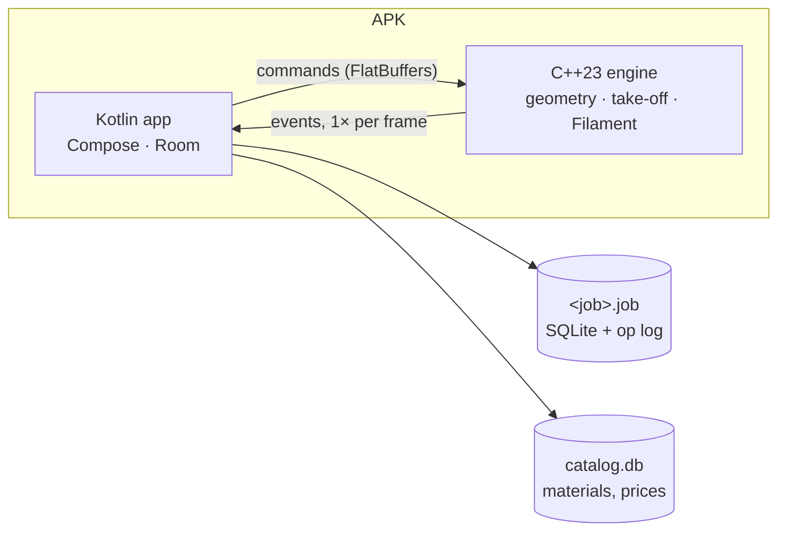

# Otves

Otves (Отвес) is an Android app for private builders in Uzbekistan and Russia: measured plans, 3D, material take-off, estimates and site spending for one job in one place.



## Quick start

```sh
export VCPKG_ROOT=~/development/vcpkg          # vcpkg 2026.10.16
cd engine && cmake --preset desktop-asan && cmake --build --preset desktop-asan && ctest --preset desktop-asan
cd ../android && ./gradlew build              # downloads JDK 25 on first run
```

## Repository

| Path | Contents |
|---|---|
| `android/` | Kotlin app: `app`, `core/model`, `core/designsystem`, convention plugins in `build-logic` |
| `engine/` | C++23 design engine: `core` (levels, walls and openings, commands, operation log, undo), `geom` (wall joins, plan outlines), `takeoff` (wall quantities, masonry units and mortar, Luau rules sandbox) |
| `content/` | Norm tables and take-off rules in Luau, shipped as a content bundle |
| `docs/brand/` | Logo, mark and launcher icon sources |
| `docs/` | Architecture, decisions (ADRs), glossary, brand, research |

## Build and test

| Task | Command |
|---|---|
| Engine tests, AddressSanitizer + UBSan | `ctest --preset desktop-asan` (in `engine/`) |
| Engine tests, ThreadSanitizer | `cmake --preset desktop-tsan`, then build and `ctest` with the same preset |
| C++ format check | `clang-format --dry-run --Werror` on `engine/**/*.{h,cpp}` |
| C++ static analysis | `run-clang-tidy -p build/desktop-asan` (in `engine/`) |
| App build, unit tests, Android Lint | `./gradlew build` (in `android/`) |
| Kotlin format | `./gradlew spotlessApply` |

Toolchain: CMake ≥ 4.0, Ninja, Clang (AppleClang or LLVM 23), LLVM 23 clang-format and clang-tidy, Android SDK platform 37. Exact versions are in `android/gradle/libs.versions.toml` and `engine/vcpkg.json`.

Choose the compiler (`CC`, `CXX`) before the first configure of a build folder. vcpkg builds dependencies with the same one; sanitizer runtimes from two compilers do not link.

## Docs

- [Architecture](docs/architecture.md)
- [Decisions](docs/adr/)
- [Glossary](docs/glossary.md)
- [Research: standards](docs/research/Qurilish%20standartlari%20va%20materiallar.md), [materials and prices](docs/research/Qurilish%20materiallari%20turlari%20va%20narxlari.md)
