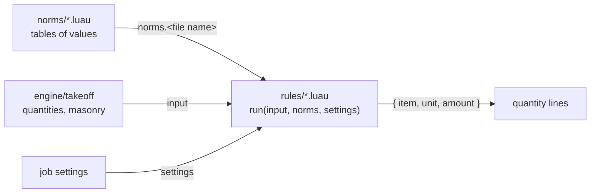

# content

Norm data and rules that turn take-off quantities into material lines. They are Luau scripts that `engine/takeoff` runs in a sandbox ([ADR 0005](../docs/adr/0005-norm-rules-in-sandboxed-luau.md)), so a norm update ships without a new APK.

## Layout

| Path | Holds |
|---|---|
| `norms/<role>.luau` | One table of values with a `source` record: standard, clause, jurisdiction, status. The file is named by its role (`mortar`, `seismic`), not by its standard, so a norm profile (UZ, RU, EU) swaps the file and rules stay the same. The name is its key in `norms` |
| `rules/<name>.luau` | `return { run = function(input, norms, settings) ... end }`, returning an array of lines |
| `catalog/<name>.json` | What the app offers the builder to choose from ([ADR 0008](../docs/adr/0008-materials-are-chosen.md)): masonry units with their sizes as laid and the wall thicknesses they build, ring beam heights. No prices |

## Rule contract

| Value | Fields |
|---|---|
| `input.walls[i]` | `id`, `thickness` m, `footprint_area` m², `length` m, `face_area` m² and `volume` m³ net of openings, `openings_area` m², `ring_beam` m (the beam its storey asks for, 0 for none), `footing_width` and `footing_depth` m (the strip footing its storey asks for, 0 for none) |
| `input.lintels[i]` | `opening`, `wall`, `length` m to order, `height` m, `thickness` m |
| `input.junctions[i]` | `walls` (ids), `height` m of the lowest of them, `meshes` (whether its storey asks for them) |
| `input.masonry` | `units`, `mortar` m³, `walls[i]` with `id`, `units`, `mortar`, `by_unit[i]` with `length`, `width`, `height` mm, `units`, `mortar` |
| `settings` | The job's estimating conditions by name, numbers or strings; ones the builder left unset are `nil` |
| line | `item` (`a-z 0-9 _ .`, ≤ 64), `unit` (`pcs`, `m`, `m2`, `m3`, `kg`), `amount` (finite, ≥ 0) |

The engine adds no waste and no rounding; the rule does both. An item is made of the items named after it and a dot (`mortar` of `mortar.cement` and `mortar.sand`, `mortar.cement` of `mortar.cement.bag50`); the app prices the parts, not the whole. One rule may not return the same item and unit twice.

## Writing rules

- Available: `base` without `print`, `pcall` and `getfenv`, plus `table`, `string` and the exact part of `math` (`abs ceil clamp floor fmod max min modf round sign sqrt`).
- Not available: `os`, `debug`, `math.random`, trigonometry, `exp`, `log`. Write `x * x`, not `x ^ 2`: `^` calls the platform `pow`, whose last bit differs between phones and CI.
- Norms, input, settings and library tables are read-only. Globals set by one rule are invisible to the others.
- Each script gets 1 000 000 steps; a run gets 32 MiB.

## Files

| File | Content | Source |
|---|---|---|
| `norms/losses.luau` | Concrete placement losses: 1.8 % foundations and slabs, 2.8 % beams and columns | Сборник типовых норм потерь (к РДС 82-202-96), table 1, item 42 |
| `norms/masonry.luau` | Joints: 12 mm bed, 10 mm head | СП 70.13330.2012, 9.2.4 |
| `norms/mortar.luau` | Cement per m³ of masonry mortar and per m³ of its sand, by cement and mortar grade | СП 82-101-98, tables 4–5 |
| `norms/practice.luau` | Waste allowances (запас), default cement, mortar grade and seismic intensity, lintel bar 2ПБ 120 × 140, ring beam B15 A500С | Practice; ГОСТ 948-2016 table 1; editable in job settings |
| `norms/reinforcement.luau` | Cover of a footing cast without blinding, minimum longitudinal reinforcement, stirrup pitch | СП 63.13330.2018, 10.3.2, 10.3.6, 10.3.13 |
| `norms/rebar.luau` | Nominal bar mass per metre by diameter | ГОСТ 34028-2016, table 1 |
| `norms/seismic.luau` | Detailing asked for from 7 points; lintel bearing 350 mm (250 mm up to a 1 500 mm opening); ring beam ≥ 150 mm, ≥ B12.5, 4Ø10 / 4Ø12 / 4Ø14 by intensity; junction meshes 1.5 m, ≥ 1 cm², every 700 mm (7–8 points) or 500 mm (9) | КМК 2.01.03-19, 3.5.10–3.5.12, 3.5.15 |
| `rules/footing.luau` | Strip footing under walls ≥ 250 mm of the storeys that ask for one: concrete `concrete.b20` with losses, bars `rebar.a500c.d12`, stirrups `rebar.a240.d8`, `formwork` m² on both sides | `reinforcement`, `losses`, `rebar`, `practice` |
| `rules/masonry.luau` | Units with waste, one line per unit size (`masonry_unit.250x120x65`), mortar with waste, cement in that mortar by weight and in bags, its sand; nothing until a wall has a unit | `mortar`, `practice` |
| `rules/lintels.luau` | Bar lintels by length: `lintel.bar.l22` is a bar at least 2.2 m long, as many side by side as the wall is thick | `practice` |
| `rules/ring_beam.luau` | Ring beam on walls ≥ 250 mm of the storeys that ask for one: concrete `concrete.b15` with losses, bars `rebar.a500c.d12` with laps; fails under the КМК minimum of 150 mm | `seismic`, `losses`, `rebar`, `practice` |
| `rules/junction_meshes.luau` | `mesh.junction` pieces where two or more walls ≥ 250 mm meet on the storeys that ask for them, one per pitch below the top; fails above 9 points, where КМК 3.5.1 meshes are not modelled |
| `catalog/masonry_units.json` | 1НФ, 1,4НФ and 2,1НФ (ГОСТ 530-2012), 390 × 190 × 188 block (ГОСТ 6133-2019) | the standards |
| `catalog/conditions.json` | The values offered for each estimating condition, with the default of `norms/practice` | [ADR 0009](../docs/adr/0009-job-conditions.md) |
| `catalog/ring_beam.json` | Ring beam heights from 150 mm | КМК 2.01.03-19, 3.5.10 | `seismic`, `practice` |

## Settings

| Setting | Unit | Default | Read by |
|---|---|---|---|
| `unit_waste`, `mortar_waste` | fraction | `practice.waste` | `masonry` |
| `cement`, `mortar_grade` | `PC400`, `M100` | `practice.defaults` | `masonry` |
| `seismic_intensity` | points | 9 | `ring_beam`, `junction_meshes` |
| `ring_beam_concrete` | class (`15` for B15) | 15 | `ring_beam` |

Wall height is the masonry: the ring beam sits on top of it. Walls thinner than 250 mm (`practice.walls`) count as partitions until walls carry a load-bearing flag.

The engine also reads `seismic.lintel` and `practice.lintel.height` to place lintels (`lintel_spec`), and `masonry.joints` to count each wall's units (`masonry_joints`). The unit is the wall's own, and the ring beam and meshes its storey's. With `seismic.detailing_from` and `practice.defaults.seismic_intensity` it reports the storeys that lack a ring beam or meshes the norm asks for (`seismic_advice`); it never adds them. GOST 948 marks are not chosen yet: their length table is not verified.
