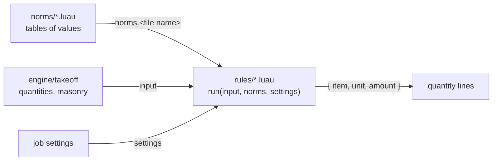

# content

Norm data and rules that turn take-off quantities into material lines. They are Luau scripts that `engine/takeoff` runs in a sandbox ([ADR 0005](../docs/adr/0005-norm-rules-in-sandboxed-luau.md)), so a norm update ships without a new APK.

## Layout

| Path | Holds |
|---|---|
| `norms/<name>.luau` | One table of values with a `source` record: standard, clause, jurisdiction, status. The file name is its key in `norms` |
| `rules/<name>.luau` | `return { run = function(input, norms, settings) ... end }`, returning an array of lines |

## Rule contract

| Value | Fields |
|---|---|
| `input.walls[i]` | `id`, `thickness` m, `footprint_area` m², `length` m, `face_area` m² and `volume` m³ net of openings, `openings_area` m² |
| `input.masonry` | `units`, `mortar` m³, `walls[i]` with `id`, `units`, `mortar` |
| `settings` | Job settings by name, numbers or strings; absent ones are `nil` |
| line | `item` (`a-z 0-9 _ .`, ≤ 64), `unit` (`pcs`, `m`, `m2`, `m3`, `kg`), `amount` (finite, ≥ 0) |

The engine adds no waste and no rounding; the rule does both. One rule may not return the same item and unit twice.

## Writing rules

- Available: `base` without `print`, `pcall` and `getfenv`, plus `table`, `string` and the exact part of `math` (`abs ceil clamp floor fmod max min modf round sign sqrt`).
- Not available: `os`, `debug`, `math.random`, trigonometry, `exp`, `log`. Write `x * x`, not `x ^ 2`: `^` calls the platform `pow`, whose last bit differs between phones and CI.
- Norms, input, settings and library tables are read-only. Globals set by one rule are invisible to the others.
- Each script gets 1 000 000 steps; a run gets 32 MiB.

## Files

| File | Content | Source |
|---|---|---|
| `norms/sp_82_101_98.luau` | Cement per m³ of masonry mortar by cement and mortar grade | СП 82-101-98, tables 4–5 |
| `norms/practice.luau` | Waste allowances (запас), default cement and mortar grade | Practice; editable in job settings |
| `rules/masonry.luau` | Units and mortar with waste, cement in that mortar | Uses both norms above |
