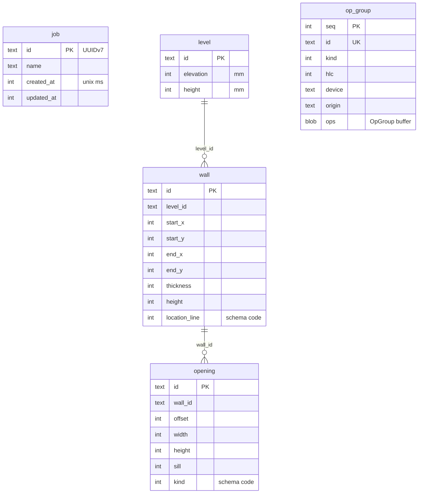

# 0007. Mirror engine responses into the job file

Status: accepted    Date: 2026-11-08

## Context

ADR 0003 stores each job as one SQLite file with an operation log. The engine owns the model but never touches files (ADR 0002). The app must save after every edit without blocking a drag, and open a 5 000-element job in under 1 s.

## Decision

- The app writes the file. After each engine response it writes, in one transaction:
  - the changed elements, as row upserts and deletions;
  - the operation-log groups the request appended.
- Each new group comes in the response as a `LogEntry`:
  - index columns: id, kind, stamp, device and origin;
  - `ops`, a finished `OpGroup` FlatBuffer (identifier `OTVG`), stored as is.
  The app never reads `ops`. Only the engine decodes them, for history and sync.
- To open a job, the app reads the element rows and the newest stamp and sends `OpenModel`. The engine then:
  - replaces its model;
  - starts an empty log, with no undo or redo;
  - keeps its clock past that stamp.
- One job is open at a time. It lives at `filesDir/jobs/<job id>.job`.
- Room with the bundled SQLite driver. Schemas are exported to `android/data/project/schemas/`, and every change ships a migration and a test.

Version 2 adds `ring_beam` and `junction_meshes` to `level` and `unit_length`, `unit_width`, `unit_height` to `wall` ([ADR 0008](0008-materials-are-chosen.md)).

Ids are canonical UUID text. Lengths are whole millimetres. Enums are the codes of `schema/engine.fbs`.

## Consequences

- Undo history ends when the job closes. The log stays, for history and sync.
- A crash between the engine applying a command and the write loses at most that command.
- Rows repeat what the log could rebuild. Opening reads rows, so it never replays the log.
- Listing jobs opens every file. An index file comes when the list grows slow.
