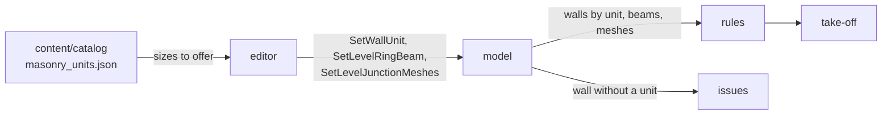

# 0008. Materials are chosen, not assumed

Status: accepted    Date: 2026-11-10

## Context

The first editor counted every wall as 1НФ brick and added a ring beam and junction meshes to every job from norm defaults. A builder could not say what the walls are made of, and the take-off listed materials nobody asked for. Builders buy what they decided to build; the norms tell them what is missing, they do not order it.

## Decision

- The take-off lists only what the model says.
- A wall carries its masonry unit as laid: `unit_length`, `unit_width`, `unit_height` in millimetres. All zero means not chosen; such a wall gets no units and no mortar and is reported as an issue.
- A level carries its seismic detailing: `ring_beam`, the beam's height in millimetres on top of its load-bearing walls (zero for none), and `junction_meshes`.
- Unit sizes offered to the user come from `content/catalog/masonry_units.json`. A wall stores sizes, not a catalog id, so a catalog change never changes a saved job and a custom size needs no catalog entry.
- Masonry lines are per unit size: `masonry_unit.250x120x65`.
- Lintels stay derived: an opening cannot stand without one.

## Consequences

- Bridge schema: `Wall` and `Level` gain fields with zero defaults, three commands and three command kinds are appended. Old buffers read as "not chosen".
- Job file version 2: `wall` gains three columns and `level` two, all zero by migration. Walls of version 1 jobs lose their assumed brick until the user picks one.
- Joint thickness stays a norm (`norms/masonry`), so thin-joint blocks on glue need a joint per unit before they are offered.
- Norm checks that recommend a ring beam or meshes belong to issues, not to the take-off.
