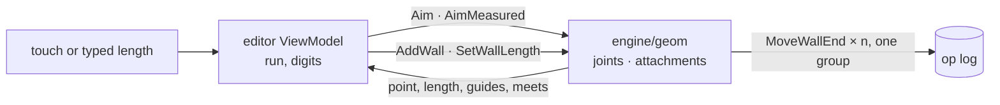

# 0011. Plan editing is geometry, so the engine does it

Status: accepted    Date: 2026-11-10

## Context

Rule 1 of the architecture says Kotlin never computes geometry. The editor broke it: snapping, meeting a wall along its length, typed lengths and measured runs were written in the view model, over its own copy of the walls. Typing a length there moved one corner and skewed the wall beside it; the copy lagged behind the engine; the tests ran against a 200-line fake of the engine instead of the geometry.

Underneath is a question about the model. Walls are independent: each keeps its own two points, and walls join where points are equal to the millimetre or where an end lies inside another wall's body (`geom::join_walls`). Nothing says "this corner" or "this wall stands against that one".

## Decision

- **The engine answers every geometric question of editing.** Two queries change nothing: `Aim` (where a wall would end under the finger: caught by wall ends, held to the axes, lined up with other ends, met with a wall along its length) and `AimMeasured` (where a wall of a typed length ends, turning left, straight or right from the wall before). One command edits: `SetWallLength`.
- **Topology is read off the geometry, by one definition.** Ends at one point are a joint. An end inside another wall's body, away from that wall's ends, is attached to it. `join_walls`, `Aim` and `SetWallLength` share this definition, so what is drawn joined is edited joined.
- **A typed length carries what is joined.** The wall's far joint moves along the wall. A wall at a moving joint stretches when it runs along the move, and otherwise goes with it, so it keeps its direction; so do the walls attached to it and the wall it is attached to. The wall's fixed end is pinned: a wall that reaches it turns about it instead. Unless the app names it, the fixed end is the one joined to other walls when the other is free, so a partition grows from the wall it stands against; else the start. Everything is one undo step, and nothing changes when a joined wall would vanish, turn back on itself or come off the wall it stands against.
- **Kotlin keeps the conversation, not the geometry**: which tool, the point the next wall starts from, the digits typed so far.

## Alternatives

**Corner nodes as elements, walls referring to them.** A shared corner becomes one thing: moving it is one operation, and edits from two devices merge on it. It does not remove the work above: keeping a room square is a propagation over the graph either way, and a wall standing against another along its length is still found by geometry unless walls are split there, which a builder does not see as two walls. It is a one-way door through every layer and the job file. Not now. The editing code sees the plan only as joints and attachments, so nodes can replace how those are found without touching it.

**Fix the view model.** Cheaper, and it leaves the rule broken, the copy of the model in place and the geometry untested.

## Consequences

- Bridge schema: two queries, one command and an `aimed` result are appended. The job file does not change.
- Editing waits for one hop to the engine thread. Aims while a finger moves are conflated to the latest.
- The view model no longer copies walls to compute with; the snapping tests move to `engine/geom`, where they run on real geometry.
- Coincidence stays an invariant of the commands: every command that moves an end must move its joint. If sync between devices arrives, concurrent edits of one corner can part it; that is the moment for corner nodes.
