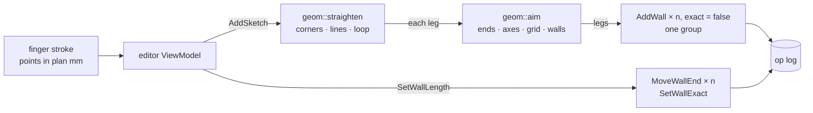

# 0012. A sketch becomes walls in the engine

Status: accepted    Date: 2026-11-13

## Context

A builder draws a house on paper in seconds: crooked lines, rounded corners, a loop that almost closes. The wall tool asks for one point at a time. A pencil tool lets him draw the same way on the phone and get walls.

Turning a stroke into walls is geometry: finding its corners, turning each leg onto an axis, joining it to walls already there. Rule 1 puts that in the engine, and ADR 0011 already holds the rules for where a wall ends.

A finger gives proportions, not sizes. Walls made from a stroke carry lengths nobody measured.

## Decision

- **One command, `AddSketch`.** It carries the stroke's points, the reach of a touch, the grid, the 90° lock and the wall to build. It runs as `AddWall` commands in one undo step. Nothing changes when the stroke gives no wall.
- **`geom::straighten` reads the stroke** in the six steps below. It is a pure function, as `aim` and `resize_wall` are.
- **A wall knows whether its length is exact.** `Wall.exact` is true by default and false for a sketched wall. `SetWallLength` makes its wall exact, also when the typed length is the one it has. The app writes the length of a wall that is not exact with «≈» and offers to enter the lengths one by one.
- **The stroke under the finger is input.** Kotlin draws it; it is not part of the model and no geometry is read from how it is drawn.

| Step | Rule |
|---|---|
| 1. Corners | A point further than the reach from the line between its neighbours is a corner (Ramer–Douglas–Peucker) |
| 2. Lines | A leg held to an axis, as `aim` holds a wall, lies at the middle value of its points, so a rounded corner does not move the wall. Legs that meet at a corner share its lines |
| 3. Loop | A stroke of three legs or more that ends within two reaches of its start closes on it |
| 4. Wall ends | A corner within reach of a wall end is that end, and the lines through it go where the end is |
| 5. Legs | Each leg ends where `geom::aim` puts it. The legs before it count as walls |
| 6. Runs | Legs in one line are one wall |

## Alternatives

**Straighten in the view model.** It would copy the snapping rules into Kotlin again, which ADR 0011 removed.

**A query that returns segments, then `AddWall` from the app.** Two round trips for one gesture, and the app would hold geometry between them. A command keeps the gesture one step in the log.

**Walk the corners through `aim` and nothing else.** A corner is then placed before the stroke is known to close, so the last wall of a room comes out slanted by whatever the finger was off. Steps 2 to 4 settle the lines first.

**Keep lengths approximate without a field.** The app could remember sketched walls until the editor closes. The mark would be lost with the job, and the take-off of a reopened job would look measured when it is not.

## Consequences

- Bridge schema: `Wall.exact`, the wall field `Exact`, the command `AddSketch` and the kind `SetWallExact` are appended.
- Job file version 5: `wall` gains `exact`, 1 in old jobs.
- A sketch is logged as `AddWall`. History tells a sketched wall from a drawn one by `exact` only.
- The pencil shares the wall tool's snapping, fixes and bugs alike.
- A stroke that turns back on itself gives overlapping walls; they are reported as join issues, like walls drawn by hand.
- A stroke of more than 4 096 points is read through evenly spaced ones.
- Windows and doors are not read from a sketch.
