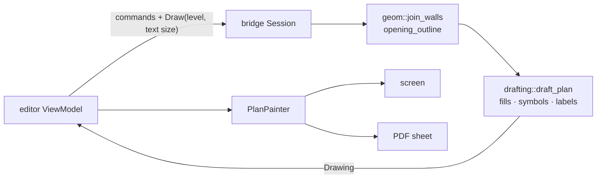

# 0013. The engine drafts the plan, Kotlin paints it

Status: accepted    Date: 2026-11-13

## Context

The app draws the plan twice, on screen (`PlanCanvas`) and on the PDF sheet (`EstimatePdf`). Both take wall and opening outlines from the engine and then work out the rest themselves: where a length is written so that it clears other walls and other lengths, a window's glazing lines, a door's leaf and swing. That is geometry in Kotlin, in two copies, which rule 1 forbids and ADR 0011 removed for editing.

Hatched wall layers, room names and areas, dimension chains, marks and schedules are all more of the same. Each would be written twice, or the screen and the sheet would drift apart.

## Decision

- **The engine answers a `Draw` query with a `Drawing`: a display list for one level.** It holds polygons, lines, arcs and texts in plan metres, each with what it is, not how it looks.
- **`engine/drafting` builds it** from the joined walls, the openings and the level below. It is pure, like `geom`, and knows no pixels and no colours.
- **Kotlin paints it.** One `PlanPainter` over `android.graphics.Canvas` serves the screen and the PDF. It maps each fill and stroke to a paint and formats numbers. It positions nothing; it may leave a text out.
- **The app says how big its text is.** `Draw` carries the height of a line of label text and the width of a digit, in plan millimetres at the current zoom. The engine places labels with them and drops the ones that do not fit.
- **Every primitive names its element.** The painter marks the selected one and the ones with issues; the engine does not know what is selected.

| Primitive | Carries |
|---|---|
| Polygon | element, points, `Fill` (wall, wall without material, opening gap), `Stroke` of its outline |
| Line | element, two points, `Stroke` (wall edge, level below, window frame, door leaf) |
| Arc | element, centre, radius, start and sweep in degrees counter-clockwise, `Stroke` |
| Text | element, kind (length, approximate length), value in millimetres, centre, angle |

Painting order is the order of the lists: polygons, then lines, arcs and texts, each list in the order given.

## Alternatives

**Send the drawing with every response, as outlines are sent.** Labels depend on the zoom, which the engine does not know and which changes without the model changing. A query carries the zoom; it rides in the same request as the commands, so an edit is still one round trip.

**Keep placement in Kotlin and share it between screen and PDF.** One copy instead of two, still outside the engine, and unreachable for the desktop viewer and the golden tests.

**Measure text in the engine.** It would need the app's fonts. Two numbers from the app are enough for digits, and names of rooms are a short list of codes.

**Draw with Filament in the engine now.** The 2D plan needs lines, hatches and text, which the display list gives a painter at once; `engine/render` can read the same list later.

## Consequences

- Bridge schema: `Draw`, `Drawing` and its primitives, `Fill`, `Stroke`, `TextKind` and `CommandResult.drawing` are appended. `Response.outlines` stays, for the plan's extent and the walls' lengths. `Response.openings` is no longer needed by the app and stays filled until slice 3 removes its last reader.
- A new engine module, `engine/drafting`, between `geom` and `bridge`.
- `PlanCanvas.dimension()`, `opening()` and `EstimatePdf.length()` are deleted. A label can no longer be placed differently on screen and on paper.
- The app asks again when the zoom changes enough to change which labels fit. Between answers the painter keeps the text size and may hide a label; it never moves one.
- Text widths are the engine's estimate from one digit's width. A font with digits of different widths gives labels that are a little off centre.
- New kinds of primitive are new enum values. An older app paints what it knows and skips the rest.
