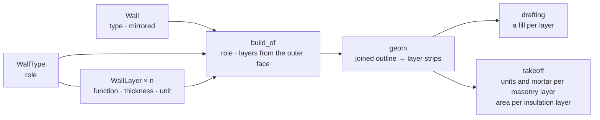

# 0014. Wall types are job elements made of layers

Status: accepted    Date: 2026-11-14

## Context

A wall has one thickness and one masonry unit. The plans builders work from show walls of several layers: 120 mm of facing brick, 100 mm of insulation, 200 mm of block. The plan hatches each layer, and the builder buys bricks, blocks and insulation separately.

A house has a handful of such walls, repeated: the outside wall, the bearing wall inside, two partitions. Changing the insulation from 80 to 100 mm must change every outside wall at once.

## Decision

- **A wall type is an element of the job, and so is each of its layers.** `WallType` holds what the wall is for; `WallLayer` holds its type, its position, what it does, its thickness and, for masonry, the unit as laid. `Create`, `Delete` and `SetField` cover both, so the op log stays property-level and the job file gets two flat tables.
- **A wall names its type.** `Wall.type` is nil for a wall with no type. A wall with a type stores no thickness and no unit of its own: the type decides them, and commands that set them on such a wall are refused.
- **One function says what a wall is built of.** `build_of(model, wall)` gives the role and the layers from the outer face in. A wall with no type is one structure layer of its own thickness and unit. Geometry, drawing and take-off read walls through it and nothing else.
- **Layers run from the outer face in.** The outer face is the wall's right face, looking from start to end, and its left when `Wall.mirrored` is set. A loop drawn counter-clockwise needs no mirroring.
- **A layer is a strip of the wall's joined outline.** `geom::layer_strips` gives each layer its strip across the wall, and `geom::clip` cuts the outline `join_walls` gave to it. `join_walls` does not change, and each layer gets its own mitre.
- **The role says whether a wall bears load.** Exterior and bearing walls do, partitions do not. A wall with no type is judged by its thickness, as before.
- **No names in the model.** The app writes «Наружная 410» from the role and the sum of the layers. Templates in `content/catalog/wall_types.json` give sizes; the job stores sizes, as ADR 0008 does for units.

| Element | Fields |
|---|---|
| `WallType` | `role`: exterior, bearing, partition |
| `WallLayer` | `type`, `position`, `function` (structure, insulation, facing, gap), `thickness`, `unit_length`, `unit_width`, `unit_height` |
| `Wall` | gains `type` and `mirrored` |

## Alternatives

**Give every wall a type when a job opens.** One type per distinct thickness and unit, written as one group of ops. It changes a job by opening it, fills the type list with entries nobody chose, and needs every old command to find or make a type. Reading walls through `build_of` gives the single path downstream without touching old jobs.

**Layers as a list inside the wall type.** One element instead of several, but changing a layer's thickness would rewrite the whole list: the op log would lose what changed.

**Keep the wall's own thickness in step with its type.** Every wall of a type would get an op when a layer changes, and a stored copy can go stale. A typed wall stores none.

**Join each layer on its own.** Layers of different walls would have to be matched at corners. Clipping the joined outline is exact where walls of one type meet and reasonable elsewhere.

## Consequences

- Bridge schema: `WallType`, `WallLayer`, `WallRole`, `LayerFunction`, `Wall.type`, `Wall.mirrored`, the commands `AddWallType`, `SetWallType`, `SetWallMirrored`, `SetWallLayer`, `SetWallTypeRole`, their kinds, field codes and ops, fills for facing and insulation, and the error `TypeDecides` are appended.
- Job file version 6: tables `wall_type` and `wall_layer`; `wall` gains `type_id` and `mirrored`. Old jobs open unchanged, with no types.
- The take-off counts units and mortar per masonry layer and adds insulation by area and thickness. A wall with no type gives the numbers it gave before.
- Lintels still span the wall's full thickness, also through insulation.
- Where walls of different types meet, layers end at the mitre and do not wrap round the corner.
- Layers are not added to or taken from a type yet; a new type is made instead. Types are not deleted.
- The app starts a type from a catalog template and does not edit its layers yet; `SetWallLayer` and `SetWallTypeRole` have no screen.
- A sketch drawn clockwise is mirrored by the engine, so the outer layer stays outside.
