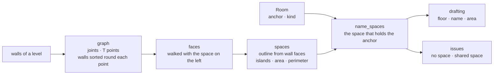

# 0015. Rooms are the spaces the walls close, named by an anchor

Status: accepted    Date: 2026-11-14

## Context

Plans name each room and give its floor area: «Спальня 11,2 м²». The area must follow the walls: when a partition moves 150 mm, two rooms change. A builder draws walls, not rooms.

The walls of a level already form a graph by the definition the joins use (ADR 0011): ends at one point are a joint, and an end inside another wall's body stands against that wall.

## Decision

- **A space is a bounded face of a level's wall graph.** Nothing stores its outline: `geom::find_spaces` derives every space of a level from its walls.
- **Its outline is the inner faces of its walls.** Each corner is where two neighbouring faces cross, the lines `join_walls` cuts footprints by. Openings do not cut it, so a doorway never opens a room.
- **What stands free inside a space is an island.** A wall or a closed group of walls joined to nothing round it takes its footprint off the space's area.
- **Topology is decided on whole millimetres.** Which ends meet, the order of walls round a point and which faces are bounded never depend on floating-point rounding. Coordinates use `+ − × ÷ √`, as the joins do.
- **A room is a name for a space.** `Room` is an element with `level`, `anchor` and `kind`. The space that holds the anchor has the name. `kind` is a code the app translates, so no strings enter the op log.
- **A space with no room is still drawn**, with its area only.
- **An anchor in no space, and a second anchor in one space, are issues.** The oldest room keeps the space.

| Element | Fields |
|---|---|
| `Room` | `level`, `anchor` (a plan point), `kind` (room, living room, kitchen, bedroom, …) |

## Alternatives

**Union the footprints with Clipper2 and take the holes.** It also reads walls that cross without being split. But the footprints of a T joint meet along a line computed in floating point, so a hairline can join two rooms unless every footprint is grown and every hole shrunk back. The library is built outside the engine's `-ffp-contract=off`, so its bits may differ between arm64 and x86-64. And it is one more dependency in four triplets.

**Store a room's outline.** The area would not follow the walls.

**Store the ids of a room's walls.** Every split, merge and removal of a wall would have to repair rooms. An anchor survives every edit that leaves it inside.

## Consequences

- Bridge schema: `Room`, `RoomKind`, the commands `AddRoom`, `SetRoomKind`, `MoveRoom` and `RemoveRoom`, their kinds, field codes and ops, the space a `Pick` finds, a fill for floors, text kinds for a room's name and area, and two issue kinds are appended.
- Job file version 7: table `room`.
- A room closes only when its walls meet by the join rules. An end 10 mm short of a wall leaves the space open; `aim` and the pencil put ends on walls.
- Walls that cross away from their ends are not split, so the spaces on both sides read as one until the crossing is fixed. The join already reports it as an overlap.
- Spaces are derived for a whole level on every change, in the time the joins take.
- Areas are in m² as the engine computes them; the app writes them to 0,1 m².
