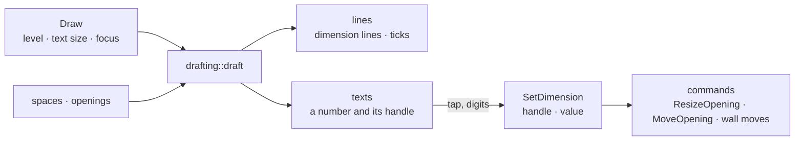

# 0016. A dimension is a handle on the model

Status: accepted    Date: 2026-11-14

## Context

The plans builders work from give every size from inside the rooms: a chain along each wall, 1 150 | 1 600 | 1 150, the room's clear size under it, 4 500, and the overall size outside, 12 700 by 9 300. A builder measures the same way, with a tape between two faces.

The editor writes one length per wall, along its location line. No room has a size, and a size cannot be changed where it is read.

## Decision

- **The engine writes the sizes.** `drafting::draft` adds dimension lines, their ticks and their numbers to the level's drawing as lines and texts. Nothing stores them.
- **Outside the plan, its overall size**, once the walls close a space: across the top and up the left side, from outer face to outer face.
- **In the space in focus, its sizes instead of its name.** `Draw` names a point; the space that holds it gets its clear size across and up the plan and, along each side with openings, a chain: wall, opening, wall.
- **A wall round a space has no length of its own on the plan**, unless nobody has typed or measured it yet. Its room's sizes say more.
- **A sheet has the sizes of every space**, beside its name and in ink. `Draw.sheet` asks for it; no wall round a space keeps a length there.
- **A number is a handle.** A text of a size says what a typed value changes: an opening's width, the opening a piece of wall leads to, or the two walls a clear size lies between. The app sends the handle back with the value as `SetDimension`, and the engine turns it into commands in one undo step.
- **A wall goes across a room at a typed distance.** `AddWallAcross` names a point of the room, which of its walls to measure from, as the hand it is on, and the distance. The engine runs the wall from the wall it meets on one hand to the one on the other. The new wall lies along its nearer face, so the distance holds whatever the wall is made of.
- **Sizes scale with the text.** Offsets and ticks are ratios of the label text's height, so a drawing reads the same at every zoom. Paper sizes of СПДС join them with the sheets.

| Size | Where | A typed value |
|---|---|---|
| Overall | Outside, across the top and up the left | — |
| Clear size | In the focused space, across near its top and up through its middle | Moves one of the two walls it lies between; what is joined follows |
| Chain: opening | Along the side the opening is in | Sets the opening's width |
| Chain: wall | Between a corner or an opening and the next opening | Moves that opening along its wall |

## Alternatives

**Dimensions as elements the user places.** Chains would lag behind the plan, as the opening schedule of the reference set lags behind its plan. Derived sizes cannot.

**The app computes what a typed size changes.** Which wall moves and how far is geometry; it would be decided twice.

**A dimension primitive of its own in the drawing.** Lines and texts already carry everything a painter needs; a handle is three fields on a text.

## Consequences

- Bridge schema: `Draw.focus`, strokes for dimension lines, text kinds for the four sizes, a handle on a text, and `SetDimension` are appended.
- `geom::translate_wall` moves a wall across the plan with what is joined to it, and `geom::set_distance` finds the move for a clear size. The app asks which of the two walls gives way.
- `geom::across` finds where a wall across a room runs. `Hand` and `AddWallAcross` are appended to the bridge schema. A wall that stands free in the room is no wall to measure from or to stand against.
- The label of a selected space gives way to its sizes, so the panel names it.
- The app remembers where it painted each number to find the one a finger taps. It still places nothing.
- A space that is not a rectangle gets the sizes of its stretches through its label point, not every side.
- A dimension line may cross a door's swing; a number never lies under another text or a line.
