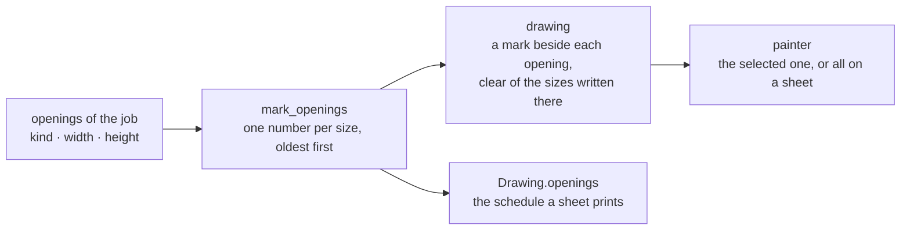

# 0017. Openings carry hinge and swing; marks are derived

Status: accepted    Date: 2026-11-14

## Context

A door on a plan says which jamb its hinges are on and which room it opens into; a builder orders and hangs it by that. Every door in the editor is drawn hinged at its near edge and open to its wall's left.

The plans mark each opening, ОК-1 or ДВ-1, and list the marks in a schedule. In the reference set the schedule was kept by hand and fell behind the plan: the plan has ОК1 to ОК7, the table ОК1 to ОК4.

## Decision

- **An opening stores its hinge and its swing.** `hinge` is the edge the leaf hangs on: the near one, towards the wall's start, or the far one. `swing` is the side the leaf opens to: the wall's left or right, looking from its start. Both are the wall's own terms, so they hold when the wall moves. A window keeps them unused.
- **Marks are derived, never stored.** Openings of one kind, width and height share a mark. A kind's marks are numbered in the order of the oldest opening of each size, so adding a size never renumbers the others. The number goes out with the drawing; the app writes the letters of the kind.
- **A mark is drawn for the selected opening on the screen and for every opening on a sheet.** The engine writes no more than that: placing every mark clear of the sizes took two thirds of a screen's drawing.
- **A mark stands by the face its leaf does not open to, or the nearest place clear of the sizes.** On a sheet both rooms have a chain along the wall, so the mark goes past one.
- **The schedule is derived with the marks.** Every drawing lists the job's marks with their sizes and counts; a sheet prints the list beside the plan, so it cannot fall behind.
- **The selected opening gets the chain of the side it is in.** `Draw` names the selected element; the engine writes wall, opening, wall along that side of the room the opening is in, each number a handle (ADR 0016).
- **Centring is the engine's.** `CenterOpening` puts an opening in the middle of the side of the room it is in, or of its wall when no room is there.

| Field | Values | Default |
|---|---|---|
| `Opening.hinge` | near, far | near |
| `Opening.swing` | left, right | left |

## Alternatives

**Store the mark on the opening.** It would have to be kept in step by hand or by every command that changes a size, and it would drift as the reference schedule did.

**Hinge and swing as the room the door opens into.** A room is derived and may not exist; the wall's own sides always do.

**Four numbered states.** Two fields say what each means and change one at a time.

## Consequences

- Bridge schema: `Hinge`, `Swing`, the two fields of `Opening`, the commands `SetOpeningHinge`, `SetOpeningSwing` and `CenterOpening`, their kinds and field codes, `Draw.selected` and a text kind for marks are appended.
- Job file version 8: `opening` gains `hinge` and `swing`; old doors keep the way they were drawn.
- Bridge schema: `ListedOpening` and `Drawing.openings` are appended for the schedule.
- A door of two leaves and a sliding door are not modelled yet.
- An opening's width, height and height over the floor are typed in its panel; the usual sizes stay beside them.
