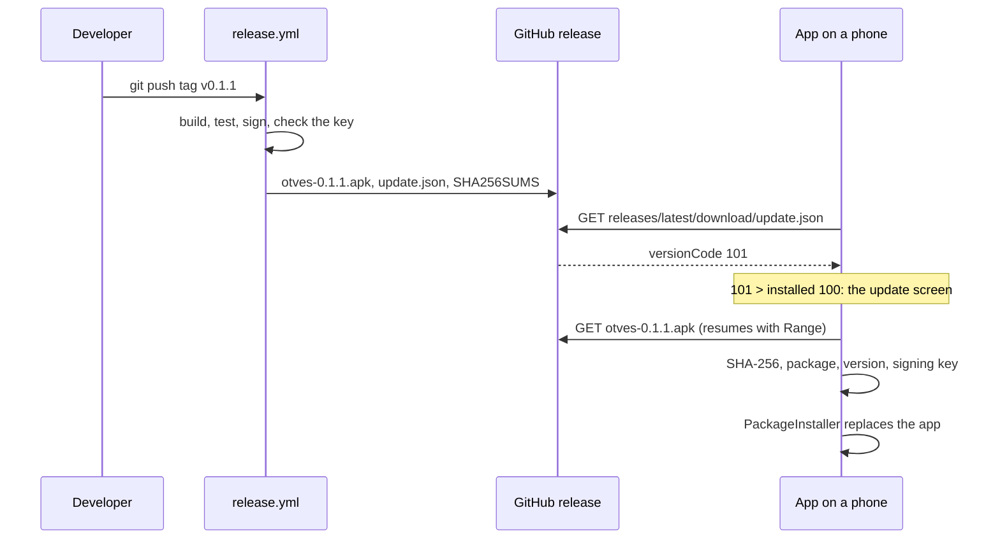

# 0018. Release on GitHub and update inside the app

Status: accepted    Date: 2026-11-27

## Context

Otves is Android only and is not on Google Play, so nothing updates it for the builder. A builder who keeps an old version keeps its bugs, and a later `.job` format would meet apps that cannot read it.

From 2027 certified Android devices install an app only when its package name and signing key are registered to a verified developer ([Android developer verification](https://developer.android.com/developer-verification/guides)).

GitHub's REST API answers 60 requests an hour per IP address without a token, and phones behind one mobile operator share addresses.

## Decision

- **A release is a tag `vMAJOR.MINOR.PATCH` on `main`.** `release.yml` builds the APK, signs it and publishes `otves-<version>.apk`, `update.json` and `SHA256SUMS` as a GitHub release. The version code is `MAJOR·10000 + MINOR·100 + PATCH`, so it grows with every release.
- **The app reads one file.** It asks for `releases/latest/download/update.json`, a plain redirect that the API limit does not count. The format is ours, so the feed can move to another host by changing one address.
- **Every newer version is mandatory.** An app that sees a higher `versionCode` shows the update screen and nothing else. There is no "later".
- **An update never interrupts work.** The screen replaces the jobs list only; an open job stays open until the builder leaves it. A phone with no answer from the feed opens as usual, because a building site often has no signal.
- **The app trusts the key, not the file.** After the download it checks the SHA-256, the package name, the version and that the APK is signed with the installed app's key. Android checks the key again when it installs.
- **Android's `PackageInstaller` installs the file.** On Android 12 and later an app that updates itself needs no confirmation once the builder has allowed it to install packages. If that fails, the next try opens Android's own installer screen on the same file.
- **One signing key for the app's life.** It reaches CI through secrets and never lies in the repository. The workflow refuses to publish an APK signed with any other key.
- **A build for Google Play would be a separate flavour without the updater.** Play forbids an app to update itself by other means.

| Field of `update.json` | Meaning |
|---|---|
| `schema` | 1; a reader ignores fields it does not know |
| `versionCode`, `versionName` | The release; a higher code than the installed one means an update |
| `apk.url`, `apk.sha256`, `apk.size` | Where the APK is, its SHA-256 in hex and its size in bytes |
| `notes.<language>[]` | What changed, as `icon`, `title`, `text`, for `ru`, `uz-Latn`, `uz-Cyrl`; from `android/release-notes/<version>.json` |

## Consequences

- A fix reaches every phone that opens the app with a network, and old versions die out, so each `.job` migration has to support one version back, not all of them.
- The app now uses the network and three permissions: `INTERNET`, `REQUEST_INSTALL_PACKAGES`, `UPDATE_PACKAGES_WITHOUT_USER_ACTION`. The builder flips Android's "install unknown apps" switch once.
- A bad release locks everyone out until the next one, so `release.yml` runs the whole build and its tests before it publishes, and a fix is always a higher version, never a withdrawn one.
- Losing the signing key ends updates: every builder would have to uninstall the app, and its jobs with it. The key needs two offline copies.
- Android stops an app to replace it and does not start it again, so after an update the builder opens Otves once more; a line of text says so.
- The package name and key must be registered in the Android Developer Console before the first public release.

## Alternatives

**Google Play with In-App Updates.** It needs a developer account and a review for each release, and it is not where builders in Uzbekistan get this app today. It stays open as a second flavour.

**The GitHub REST API (`/releases/latest`).** It needs no extra file, but the hourly limit per address would fail whole neighbourhoods at once, and its format is GitHub's.

**Optional updates with a "later" button.** Builders would stay on old versions, and each format change would need migrations from all of them.
