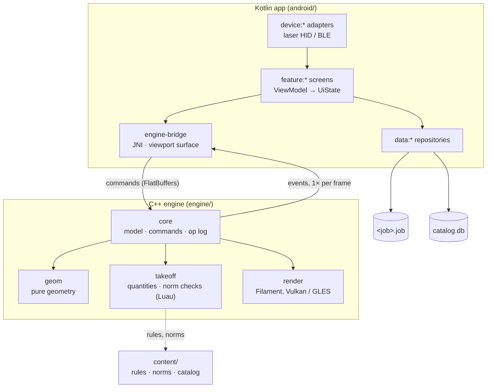
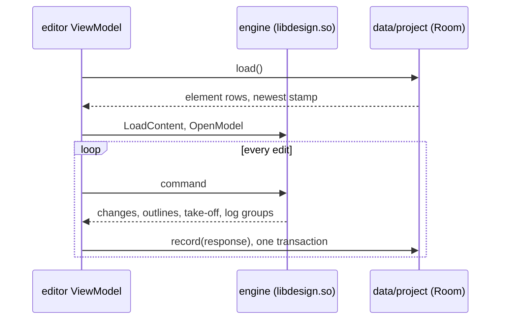

# Architecture

Otves is two programs in one APK: a Kotlin app that owns screens, business data and files, and a C++23 engine that owns the open model and everything derived from it.

## Modules

| Module | Role | Status |
|---|---|---|
| `engine/core` | Units (`Mm`), ids (UUIDv7), hybrid clock, levels with their strip footing, ring beam and junction meshes, walls with their masonry unit, openings, the job's estimating conditions, commands, document with op log, undo, gestures and opening a saved job | exists |
| `engine/geom` | Wall joins, plan outlines and junctions (`join_walls`); the wall under a point and opening outlines; where a wall being drawn ends (`aim`) and what moves with a wall given a length (`resize_wall`) | exists |
| `engine/takeoff` | Wall quantities net of openings and lintels, masonry units and mortar per chosen unit, Luau rules sandbox (`RuleSet`) | exists |
| `content/` | Norm tables and rules in Luau: mortar, cement, lintels, strip footings, ring beams, junction meshes; the catalog of masonry units and ring beam heights to choose from | exists |
| `engine/bridge` | `Session` over FlatBuffers requests (`schema/engine.fbs`): commands, opening placement and picking at a tap, aiming a wall and giving one a typed length (ADR 0011), outlines with lengths, issues, take-off, op-log groups for the job file; JNI functions of `libdesign.so` | exists |
| `engine/render`, `export` | Drawing, PDF/DXF/IFC | planned |
| `android/core/model` | Value types shared by features: `Mm`, `Money`, `ElementId` | exists |
| `android/core/designsystem` | Colour roles, dimensions, theme, segmented control | exists |
| `android/app` | Activity, splash, Navigation 3 back stack from the job list to the editor | exists |
| `android/data/project` | One Room file per job (`<job id>.job`): element rows and the op log, written after every engine response (ADR 0007) | exists |
| `android/data/catalog` | The app-wide catalog database: the builder's own price for one unit of each take-off item, the same for every job | exists |
| `android/engine-bridge` | Builds `libdesign.so` from `engine/` with vcpkg and NDK r30; `EngineSession.send` with typed commands and responses | exists |
| `android/feature/projects` | The jobs on this phone, newest first; create, rename, delete | exists |
| `android/feature/editor` | Plan of a job storey by storey: walls drawn in a run by touch or drag, aimed by the engine (90° lock, wall ends, lines through them, onto walls), walls entered by measured lengths and turns, exact lengths typed on a number pad with joined walls carried along, windows and doors by a tap on a wall, the wall material chosen from the catalog or typed as a size of the builder's own, a select tool with an inspector (material, length, thickness, kind, size, delete), a strip footing, ring beam and junction meshes chosen per storey, the job's estimating conditions (seismic intensity, cement, mortar, waste), a price typed per take-off line with line costs and a total, shared as text or as a PDF sheet with the plan, wall lengths and issues on the plan, undo/redo, the take-off in a panel, shared as text; drawn from engine outlines | exists |
| `android/feature/*` (estimate, ledger, …), `device/*` | Screens, hardware | planned |

## Rules that hold everywhere

1. Kotlin never computes geometry or quantities; the engine never touches UI, storage or Android APIs except through its bridge.
2. Every model change is a command that records `{element, property, old, new}`; undo, history and sync read only that log.
3. The bridge schema and the `.job` format are versioned; each change ships with a migration and a golden test.
4. Lengths typed or measured on site are integer millimetres; money is integer minor units plus a currency.
5. Numbers from standards (КМК, СП, ГОСТ, EN) live in `content/`, not in code.
6. The take-off lists only what the builder chose; norms report what is missing (ADR 0008).
7. UI text goes through resources: Russian first, Uzbek Latin and Cyrillic second.
8. A change merges only with formatting, lint, tests and sanitizers green.

## Saving a job

## Threads

| Thread | Owns |
|---|---|
| UI (Compose) | Screens and panels; never calls into the engine |
| Engine | Commands and the model |
| Engine workers | Geometry rebuilds of dirty elements, as pure tasks |
| Filament render | GPU submission |
| IO dispatcher | Room transactions |

## Performance budgets

| Measure | Budget |
|---|---|
| Plan pan and zoom | 120 fps |
| 3D orbit | 60 fps |
| Drag a wall until views and totals update | next frame |
| Open a 5 000-element job | under 1 s |

Decisions behind these choices are in [`adr/`](adr/).
