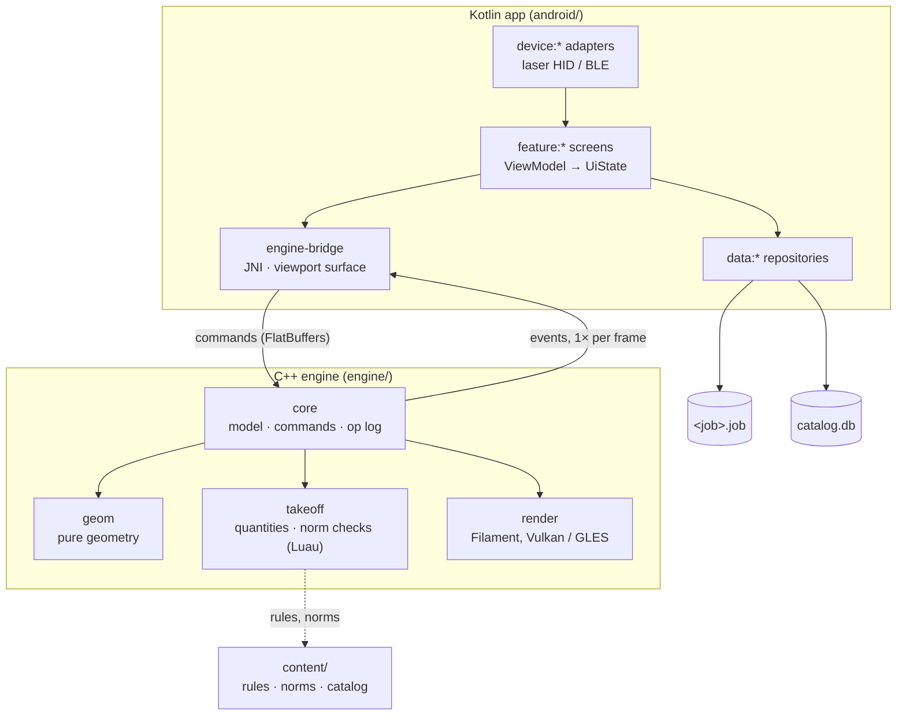

# Architecture

Otves is two programs in one APK: a Kotlin app that owns screens, business data and files, and a C++23 engine that owns the open model and everything derived from it.

## Modules

| Module | Role | Status |
|---|---|---|
| `engine/core` | Units (`Mm`), ids (UUIDv7), hybrid clock, wall model, commands, document with op log, undo and gestures | exists |
| `engine/geom` | Wall joins and plan outlines (`join_walls`) | exists |
| `engine/takeoff` | Wall quantities, masonry units and mortar (`measure_walls`, `count_masonry`) | exists |
| `engine/takeoff` rules, `render`, `export`, `bridge` | Norm rules (Luau), drawing, PDF/DXF/IFC, JNI | planned |
| `android/core/model` | Value types shared by features: `Mm`, `Money` | exists |
| `android/core/designsystem` | Colour roles, dimensions, theme | exists |
| `android/app` | Activity, splash, navigation root | exists |
| `android/feature/*`, `data/*`, `device/*`, `engine-bridge` | Screens, persistence, hardware, engine binding | planned |

## Rules that hold everywhere

1. Kotlin never computes geometry or quantities; the engine never touches UI, storage or Android APIs except through its bridge.
2. Every model change is a command that records `{element, property, old, new}`; undo, history and sync read only that log.
3. The bridge schema and the `.job` format are versioned; each change ships with a migration and a golden test.
4. Lengths typed or measured on site are integer millimetres; money is integer minor units plus a currency.
5. Numbers from standards (КМК, СП, ГОСТ, EN) live in `content/`, not in code.
6. UI text goes through resources: Russian first, Uzbek Latin and Cyrillic second.
7. A change merges only with formatting, lint, tests and sanitizers green.

## Threads

| Thread | Owns |
|---|---|
| UI (Compose) | Screens and panels; never calls into the engine |
| Engine | Commands and the model |
| Engine workers | Geometry rebuilds of dirty elements, as pure tasks |
| Filament render | GPU submission |
| IO dispatcher | Room transactions |

## Performance budgets

| Measure | Budget |
|---|---|
| Plan pan and zoom | 120 fps |
| 3D orbit | 60 fps |
| Drag a wall until views and totals update | next frame |
| Open a 5 000-element job | under 1 s |

Decisions behind these choices are in [`adr/`](adr/).
