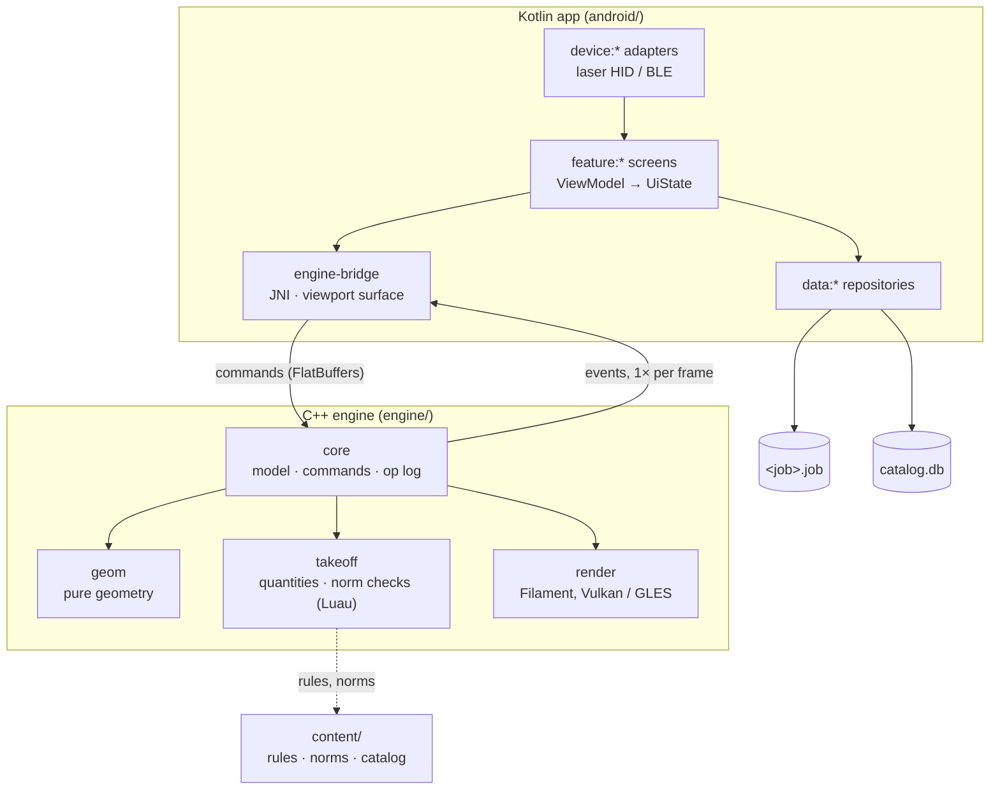
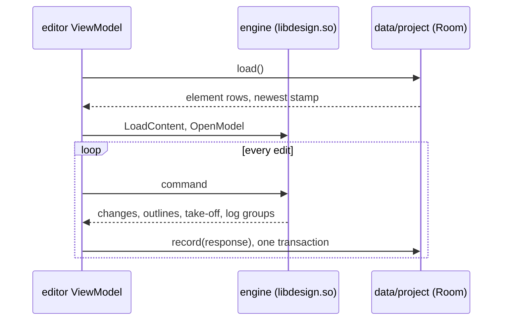

# Architecture

Otves is two programs in one APK: a Kotlin app that owns screens, business data and files, and a C++23 engine that owns the open model and everything derived from it.

## Modules

| Module | Role | Status |
|---|---|---|
| `engine/core` | Units (`Mm`), ids (UUIDv7), hybrid clock, levels, walls and openings, commands, document with op log, undo, gestures and opening a saved job | exists |
| `engine/geom` | Wall joins, plan outlines and junctions (`join_walls`); the wall under a point and opening outlines | exists |
| `engine/takeoff` | Wall quantities net of openings and lintels, masonry units and mortar, Luau rules sandbox (`RuleSet`) | exists |
| `content/` | Norm tables and rules in Luau: masonry units, mortar, cement, lintels, ring beams, junction meshes | exists |
| `engine/bridge` | `Session` over FlatBuffers requests (`schema/engine.fbs`): commands, opening placement at a tap, outlines, take-off, op-log groups for the job file; JNI functions of `libdesign.so` | exists |
| `engine/render`, `export` | Drawing, PDF/DXF/IFC | planned |
| `android/core/model` | Value types shared by features: `Mm`, `Money`, `ElementId` | exists |
| `android/core/designsystem` | Colour roles, dimensions, theme, segmented control | exists |
| `android/app` | Activity, splash, Navigation 3 back stack from the job list to the editor | exists |
| `android/data/project` | One Room file per job (`<job id>.job`): element rows and the op log, written after every engine response (ADR 0007) | exists |
| `android/engine-bridge` | Builds `libdesign.so` from `engine/` with vcpkg and NDK r30; `EngineSession.send` with typed commands and responses | exists |
| `android/feature/projects` | The jobs on this phone, newest first; create one | exists |
| `android/feature/editor` | Plan of a job storey by storey: walls by two taps, windows and doors by a tap on a wall, a select tool with an inspector (thickness, kind, size, delete), undo/redo, the take-off below; drawn from engine outlines | exists |
| `android/feature/*` (estimate, ledger, …), `data/catalog`, `device/*` | Screens, prices, hardware | planned |

## Rules that hold everywhere

1. Kotlin never computes geometry or quantities; the engine never touches UI, storage or Android APIs except through its bridge.
2. Every model change is a command that records `{element, property, old, new}`; undo, history and sync read only that log.
3. The bridge schema and the `.job` format are versioned; each change ships with a migration and a golden test.
4. Lengths typed or measured on site are integer millimetres; money is integer minor units plus a currency.
5. Numbers from standards (КМК, СП, ГОСТ, EN) live in `content/`, not in code.
6. UI text goes through resources: Russian first, Uzbek Latin and Cyrillic second.
7. A change merges only with formatting, lint, tests and sanitizers green.

## Saving a job

## Threads

| Thread | Owns |
|---|---|
| UI (Compose) | Screens and panels; never calls into the engine |
| Engine | Commands and the model |
| Engine workers | Geometry rebuilds of dirty elements, as pure tasks |
| Filament render | GPU submission |
| IO dispatcher | Room transactions |

## Performance budgets

| Measure | Budget |
|---|---|
| Plan pan and zoom | 120 fps |
| 3D orbit | 60 fps |
| Drag a wall until views and totals update | next frame |
| Open a 5 000-element job | under 1 s |

Decisions behind these choices are in [`adr/`](adr/).
