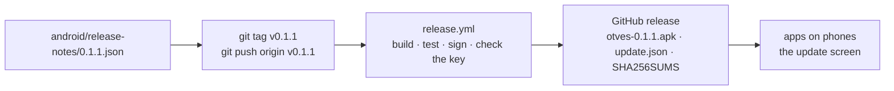

# Releasing

A release is a tag on `main`; CI builds, signs and publishes it, and installed apps update themselves from it ([ADR 0018](adr/0018-releases-on-github-and-updates-in-the-app.md)).



## Once: the signing key

Android takes an update only from the key that signed the installed app. Losing the key means every builder uninstalls the app and loses its jobs.

```sh
keytool -genkeypair -keystore otves-release.jks -alias otves \
  -keyalg RSA -keysize 4096 -validity 10000 -dname "CN=Otves"
```

Keep `otves-release.jks` and its passwords in two places off this computer. Then give CI the key and the digest of the certificate it must see:

```sh
base64 -i otves-release.jks | gh secret set OTVES_KEYSTORE_BASE64
gh secret set OTVES_KEYSTORE_PASSWORD
gh secret set OTVES_KEY_ALIAS --body otves
gh secret set OTVES_KEY_PASSWORD
gh variable set OTVES_CERT_SHA256 \
  --body "$(keytool -exportcert -keystore otves-release.jks -alias otves | shasum -a 256 | cut -d' ' -f1)"
```

Before the first public release, register the package `uz.otves.app` and this key in the [Android Developer Console](https://developer.android.com/developer-verification/guides). From 2027 certified devices install only registered apps.

## Every release

1. Write `android/release-notes/<version>.json`: up to three changes a builder will notice, in `ru`, `uz-Latn` and `uz-Cyrl`. Russian is required.
2. Tag the commit on `main` and push the tag: `git tag -a v0.1.1 -m "Otves 0.1.1" && git push origin v0.1.1`.
3. Watch the run: `gh run watch --exit-status`. It publishes only if the build, the tests and the key check pass.

Versions follow `0.1.x`; minor and patch stay below 100, because the version code is `MAJOR·10000 + MINOR·100 + PATCH`.

A release cannot be taken back: phones that installed it stay on it. Fix a bad release with the next version.

| `icon` in a note | Picture |
|---|---|
| `sheet` | a drawing sheet |
| `dimension` | a ruler |
| `opening`, `door`, `wall` | a window, a door, a wall |
| `sketch` | a pencil |
| `estimate` | a list |
| anything else | a plain ring |

## Try an update on an emulator

Debug builds have no feed unless one is given, and may read one over plain HTTP from the computer (`10.0.2.2`).

```sh
cd android
FEED=http://10.0.2.2:8765/update.json
./gradlew :app:assembleDebug -Potves.version=0.1.1 -Potves.updateFeed=$FEED   # the "new" version
mkdir -p /tmp/feed && cp app/build/outputs/apk/debug/app-debug.apk /tmp/feed/otves-0.1.1.apk
./gradlew :app:assembleDebug -Potves.updateFeed=$FEED                          # 0.1.0, the "installed" one
adb install app/build/outputs/apk/debug/app-debug.apk
```

Write `/tmp/feed/update.json` with `versionCode` 101, the APK's address `http://10.0.2.2:8765/otves-0.1.1.apk`, its `shasum -a 256` and size, then serve the folder with `python3 -m http.server 8765 -d /tmp/feed` and open the app.

| Build | Feed |
|---|---|
| release | `https://github.com/globallstudent/otves/releases/latest/download/update.json` |
| debug | none; `-Potves.updateFeed=<address>` sets one |
