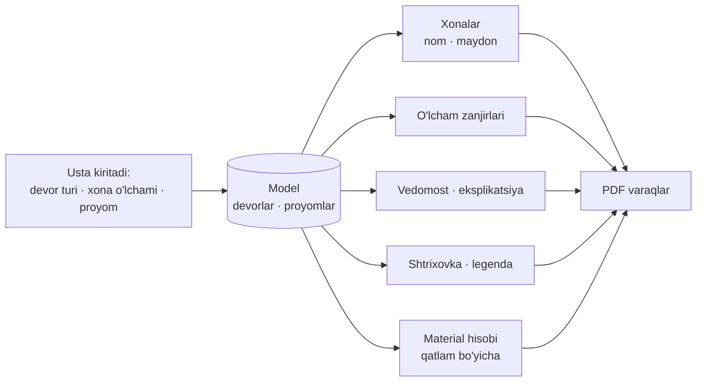

# Usta o'lcham kiritsin, chizmani model chiqarsin

Tadqiqot sanasi: 2026-11-13. 18 ta dastur o'rganildi: arxitektorlarning kompyuter dasturlari, uy rejasi uchun ommaviy dasturlar, telefon va planshet ilovalari. Maqsad: namuna chizmalarni (`План`, `План3`, `004`, АР «HOUSE 153») telefonda oddiy usta chiza olishi uchun nimani olish kerakligini aniqlash.

Asosiy xulosa: bu dasturlarning kuchi chizish asboblari sonida emas. Kuch to'rtta g'oyada:

1. Devor chiziq emas, qatlamli obyekt. Qalinlik, shtrixovka va material shundan chiqadi.
2. Aniqlik qo'l bilan emas, raqam yozish va avtomatik «yopishish» bilan beriladi.
3. O'lcham zanjiri, xona maydoni, vedomost va material hisobi modeldan o'zi chiqadi va doim mos turadi.
4. Telefon ilovalari xonadan boshlab chizadi va mavjud reja ustidan ko'chiradi.

Chizma qoidalari (SPDS: millimetr, 45° засечка, o'qlar, sath belgilari) va lazer dalnomerlar avvalgi tadqiqotda bor: [Qurilish standartlari va materiallar](Qurilish%20standartlari%20va%20materiallar.md). Bu hujjat ularni takrorlamaydi.

## O'rganilgan dasturlar

| Dastur | Turi | Bizga kerakli g'oyasi |
|---|---|---|
| ArchiCAD | BIM, kompyuter | Qatlamli devor, tayanch chiziq, Tracker, zonalar, avtomatik o'lcham |
| Revit | BIM, kompyuter | Vaqtinchalik o'lchamlar, devor yuzasiga bog'lash, xonalar, qatlam bo'yicha material |
| AutoCAD | CAD, kompyuter | Obyektga yopishish, kuzatuv chiziqlari, masofani yozish, STRETCH |
| Chief Architect / Home Designer | Uy loyihalash | Hammasi avtomatik: o'lcham, tom, poydevor, material ro'yxati |
| Sweet Home 3D | Ommaviy, kompyuter | Rasm ustidan chizish, xonani ikki marta bosib yaratish |
| Live Home 3D | Ommaviy, telefon ham | Xona asbobi, avtomatik o'lchamlar, tom yordamchisi |
| magicplan | Telefon, dala | Xonadan boshlash, rejani import qilib ustidan chizish, lazer, smeta |
| Floor Plan Creator | Android | Xona asosiy obyekt, o'lchamni raqam bilan o'zgartirish, PDF masshtabda |
| OrthoGraph | Planshet, o'lchov | Avval eskiz, keyin o'lchov; reja o'zi to'g'rilanadi |
| ArcSite | Planshet, dala | Barmoq bilan aniq chizma, chizmadan material hisobi, AI Trace |
| RoomSketcher | Veb va ilova | Devor uchini tanlab uzunlik yozish, AI Convert |
| AutoCAD mobile | Telefon | Object Snap, raqamli klaviatura, lazerdan uzunlik |
| ARES Touch | Telefon CAD | Lupa, nuqtada to'xtab kuzatish, ikkinchi barmoq bilan kiritish |
| Shapr3D | Planshet CAD | Avtomatik cheklovlar, tanlovga qarab taklif qilinadigan o'lchamlar |
| Onshape | Telefon CAD | Barmoqdan chetga surilgan aniq tanlagich |
| Bluebeam Revu | PDF | Masshtabni ikki nuqta bilan kalibrlash, PDF ustida o'lchash |
| Polycam, Planner 5D | AI | Reja rasmini tahrirlanadigan rejaga aylantirish |

## 1. Devor — qatlamli obyekt

**Dasturlarda.** ArchiCAD'da kompozit devorning har bir qatlami alohida komponent. Qatlamlar burchakda materialning kesishish ustuvorligi (Intersection Priority) bo'yicha ulanadi ([How Walls are Connected](https://community.graphisoft.com/t5/Getting-started/How-Walls-are-Connected-in-Archicad/ta-p/303922)). Devorlar faqat tayanch chiziqlari uchrashganda ulanadi. Revit'da Material Takeoff jadvali har qatlamni alohida qatorda sanaydi ([Material Takeoff Schedules](https://help.autodesk.com/cloudhelp/2023/ENU/Revit-DocumentPresent/files/GUID-F8270A42-CA71-46C7-B145-85EC2CB8E4A1.htm)). ArchiCAD qatlam maydonini, masalan izolyatsiya maydonini, ro'yxatga chiqaradi ([List Skin/Component Area](https://help.graphisoft.com/AC/19/INT/AC19Help/NewFeatures/NewFeatures-14.htm)).

**Namuna chizmalarda.** АР legendasi: 200 mm keramzit blok, 100 mm mineral paxta, 120 mm g'isht. `План` da ham uch qatlam ko'rinadi. Hozir ilovada devor bitta materialdan iborat.

**Telefonda.**

- Devor turi: qatlamlar ro'yxati (material, qalinlik, vazifa). Umumiy qalinlik qatlamlardan hisoblanadi.
- Har obyektda 3–5 ta tur yetadi: «Наружная 420», «Несущая 200», «Перегородка 100». Ular asboblar panelida tugma bo'lib turadi.
- Devorni uzoq bosib «shu turni olish» va boshqa devorga «qo'yish». Bu ArchiCAD'dagi Pick Up va Inject ([Top 12 commands](https://community.graphisoft.com/t5/Project-Management-articles/Top-12-ARCHICAD-Commands-You-Should-Use-all-the-Time/ta-p/303468)).
- Material hisobi qatlam bo'yicha: blok, izolyatsiya m², qoplama g'isht alohida.
- Ulanish ustuvorligi: yuk ko'taruvchi devor o'tib ketadi, to'siq unga tiraladi.

## 2. Tayanch chiziq devorning ichki yuzasida

**Dasturlarda.** Revit'da devor oltita chiziqdan biriga bog'lanadi: o'q, yadro o'qi, tashqi yoki ichki yuza, yadroning tashqi yoki ichki yuzasi. Ichki yuza xona o'lchami muhim bo'lganda tanlanadi. Devor turi o'zgarsa, tanlangan yuza joyida qoladi ([About the Wall Location Line](https://help.autodesk.com/cloudhelp/2020/ENU/Revit-Model/files/GUID-F26DB6DA-A0EC-424D-B656-3BDF47607F4F.htm), [Novedge](https://novedge.com/blogs/design-news/revit-tip-master-revit-wall-placement-with-the-correct-location-line)). ArchiCAD'da buni tayanch chiziq (Reference Line) bajaradi.

**Namuna chizmalarda.** Hamma o'lcham xona ichidan berilgan: 4 500, 7 260, 4 130. Usta ham shunday o'lchaydi. Devor qalinligi o'zgarsa, xona o'lchami o'zgarmasligi kerak.

**Telefonda.** Engine'da `LocationLine` bor (`kCenter`, `kLeftFace`, `kRightFace`), lekin ilovada ko'rinmaydi. Tashqi devor uchun standart holat ichki yuza bo'lsin. Shunda yozilgan uzunlik xonaning sof o'lchamini bildiradi.

## 3. Aniqlik: raqam, yopishish, kuzatuv chizig'i

| G'oya | Qayerda | Mohiyati |
|---|---|---|
| Tracker | ArchiCAD | Chizayotganda qiymatlar yoziladi; Tab maydonlar orasida o'tadi ([How to Enter Distances](https://helpcenter.graphisoft.com/?p=85299)) |
| Snap Guides | ArchiCAD | Vaqtinchalik yo'naltiruvchi chiziqlar o'zi paydo bo'ladi va kiritish tugagach yo'qoladi ([Snap Points and Guide Lines](https://help.graphisoft.com/AC/19/INT/AC19Help/NewFeatures/NewFeatures-5.htm)) |
| Object snap tracking | AutoCAD | Nuqta «olinadi», undan gorizontal va vertikal yo'l chiziladi ([Autodesk](https://help.autodesk.com/cloudhelp/2027/ENU/AutoCAD-LT/files/GUID-665DC37F-8C3E-414A-9369-72A13C0BE07A.htm)) |
| Direct distance entry | AutoCAD | Yo'nalish kursor bilan, uzunlik raqam bilan ([Precision](https://help.autodesk.com/cloudhelp/2026/ENU/AutoCAD-OnBoarding/files/ACD_FOUNDATIONS_MAIN6.html)) |
| Burchak magniti | Sweet Home 3D | Devor 15° ga karrali burchaklarga yopishadi; Enter bosib uzunlik va burchak yoziladi ([User guide](https://www.sweethome3d.com/userGuide.jsp)) |
| Mavjud nuqtadan masofa | ArchiCAD | Nuqtaga yo'naltiruvchi qo'yib, undan masofa yoziladi ([How to Enter Distances](https://helpcenter.graphisoft.com/?p=85299)) |

**Hozir bizda.** 90° qulf, devor uchiga va devor ustiga yopishish, uchlar bilan tekislash, to'r, uzunlik yozish, «По замерам» rejimi bor. Bu qism asosan tayyor.

**Yetishmaydi.**

- Devorni mavjud devordan masofa bilan boshlash: «chap burchakdan 4 500». Ichki devorlar shunday qo'yiladi.
- O'rta nuqtaga va perpendikulyarga yopishish.
- Nimaga yopishgani yozuvi: «uch», «o'rta», «devor ustida».

## 4. O'lchamni bosib geometriyani o'zgartirish

**Dasturlarda.** Revit element tanlanganda eng yaqin elementlargacha vaqtinchalik o'lchamlarni ko'rsatadi. Raqamni o'zgartirsangiz, element siljiydi ([About Temporary Dimensions](https://help.autodesk.com/cloudhelp/2018/ENU/Revit-DocumentPresent/files/GUID-74FFB00B-FB29-44B7-8FEA-613DBE010AD4.htm)). Chizish paytida «tinglovchi» o'lcham kursor bilan birga o'zgaradi ([bimmuse](https://bimmuse.com/2013/04/29/drag-listening-dimensions)). O'lcham devor o'qiga, yuzasiga yoki yadrosiga bog'lanishi sozlanadi ([Arkance](https://ukcommunity.arkance.world/hc/en-us/articles/21550599348242-Revit-Tip-How-to-control-Temporary-Dimensions-default-measurement-method)). AutoCAD'da STRETCH kesib o'tgan obyektlarni cho'zadi, ichida qolganlarini ko'chiradi ([STRETCH](https://help.autodesk.com/cloudhelp/2026/ENU/AutoCAD-LT/files/GUID-F000A502-D39E-4D31-A8E2-4A626473FB72.htm)). Floor Plan Creator'da o'lcham chiziqlari masofani ko'rsatadi va o'zgartiradi ([floorplancreator.net](https://floorplancreator.net/)). RoomSketcher'da devor uchini tanlab uzunlik yoziladi; ulangan devorlar ham siljishi mumkin ([RoomSketcher help](https://help.roomsketcher.com/hc/en-us/articles/360000202509)).

**Namuna chizmalarda.** `План` va `План 9.6` — bitta uyning ikki varianti. Xonalar chuqurligi 4 130 dan 4 280 ga o'zgargan, arxitektor varaqni qayta chiqargan.

**Telefonda.** `SetWallLength` va `resize_wall` allaqachon ulangan devorlarni birga ko'chiradi. Shu mantiq kengaytiriladi:

- Devor yoki proyom tanlanganda uning qo'shni devorlargacha masofalari ekranda chiqadi.
- Raqam bosiladi, yangi qiymat yoziladi, element siljiydi, ulangan devorlar cho'ziladi.
- Xona o'lchami (4 130) bosilsa, qaysi devor siljishi so'raladi.

## 5. Xonadan boshlab chizish va xonani avtomatik tanish

**Dasturlarda.**

- magicplan xonaga asoslangan. To'rtburchak xona (Square Room) o'lchami keyin tahrirlanadi. Bo'shliqni bo'lish uchun devor emas, yangi xona qo'shiladi ([Creating rooms](https://help.magicplan.app/creating-rooms-in-magicplan), [Editor FAQ](https://help.magicplan.app/magicplan-floor-plan-editor-faq)).
- Floor Plan Creator'da xona istalgan shaklda, faqat to'g'ri devorlar bilan. Xona, devor va qavat maydoni, perimetr avtomatik hisoblanadi ([floorplancreator.net](https://floorplancreator.net/)).
- ArchiCAD'da yopiq devorlar ichiga bosilsa zona yaratiladi. Chegara ichki yuza yoki tayanch chiziq bo'yicha olinadi ([Creating Zones](https://help.graphisoft.com/AC/29/INT/_AC29_Help/040_ElementsVB/040_ElementsVB-137.htm)).
- Revit xona maydonini standart holatda devor pardozi yuzasidan hisoblaydi. Maydon yorliqda va jadvalda chiqadi ([Room Area Boundary](https://help.autodesk.com/cloudhelp/2017/ENU/RevitLT-Model/files/GUID-0BB62832-36DD-4E06-A9D4-EE98CE0FCF89.htm)).
- Sweet Home 3D'da yopiq kontur ichiga ikki marta bosilsa xona yaratiladi ([User guide](https://www.sweethome3d.com/userGuide.jsp)).

**Namuna chizmalarda.** Har xonada nom va maydon bor: «Кухня-гостиная 30 м²». АР'da raqam va eksplikatsiya jadvali: umumiy 126,82, yashash 57,14, yordamchi 39,68 m².

**Telefonda.**

- Yopiq kontur avtomatik xona bo'ladi. Bosish shart emas.
- Nom ro'yxatdan tanlanadi: «Спальня», «Кухня-гостиная», «Санузел», «Коридор», «Котельная», «Гардероб», «Тамбур», «Терраса».
- Maydon ichki yuzalar bo'yicha. Chizmalar ham, Revit ham shunday hisoblaydi.
- «Xona» asbobi: eni va bo'yi yoziladi, to'rt devor joriy turda quriladi. Keyingi xona mavjud devorga tutashadi.
- Maydon pol, styajka va shift hisobiga uzatiladi.

## 6. O'lcham zanjirlari, vedomost va varaq avtomatik

**Dasturlarda.**

- Revit butun devorni bir bosishda o'lchamlaydi. Proyomlar markazi yoki eni bo'yicha, kesishgan devorlar ham kiradi ([Add Aligned Dimensions Automatically](https://help.autodesk.com/cloudhelp/2026/ENU/Revit-DocumentPresent/files/GUID-C26D95E4-F272-4C67-8C1D-BC26C0493B75.htm)).
- ArchiCAD tashqi o'lchamlarni to'rt turgacha chiziq bilan qo'yadi: umumiy, tashqi geometriya, devor qalinligi, proyomlar ([Automatic Exterior Dimensioning](https://help.graphisoft.com/AC/29/INT/_AC29_Help/070_Documentation/070_Documentation-49.htm)).
- Live Home 3D devor bo'laklari, proyom eni va proyomdan burchakkacha masofani qo'yadi ([2D plan view](https://www.livehome3d.com/support/help/mac/en/live-home-3d-workspace-the-2d-plan-view)).
- Chief Architect o'lchamlarni bir bosishda qo'yadi. Material ro'yxati chizish davomida yangilanadi ([Home Designer](https://www.homedesignersoftware.com/homedesign/)). Xona yorlig'ida o'lcham va maydon chiqadi ([Comparison matrix](https://cloud-hd.chiefarchitect.com/1/pdf/product-info/2018/comparison-matrix.pdf)).

**Namuna chizmalarda.** Har devor bo'ylab zanjir: 1 150 | 1 600 | 1 150, ostida 4 500. Tashqarida gabarit: 12 700 va 9 300. АР'da proyomlar vedomosti qo'lda yuritilgan va rejadan ortda qolgan: rejada ОК1–ОК7, jadvalda ОК1–ОК4.

**Telefonda.** O'lchamni usta chizmaydi, ilova chiqaradi:

- Har xona tomoni uchun zanjir: devor bo'lagi, proyom, devor bo'lagi va xonaning to'liq o'lchami.
- Tashqi gabarit.
- Ekranda zanjirlar faqat tanlangan xona uchun ko'rinadi, PDF'da hammasi.
- Proyomlar vedomosti, eksplikatsiya va shtrixovka legendasi modeldan chiqadi. Shuning uchun ular rejadan ortda qolmaydi.

## 7. Proyomlar

**Dasturlarda.** ArchiCAD'da proyom markazidan yoki chetidan qo'yiladi. Quyosh belgisi tashqi tomonni ko'rsatadi. Ikkinchi bosish to'rt holatdan ochilish yo'nalishini tanlaydi ([Placing Doors or Windows](https://help.graphisoft.com/AC/24/INT/_AC24_Help/040_ElementsVB/040_ElementsVB-302.htm)). Sweet Home 3D'da eshik devorga tortilganda devor yo'nalishi va qalinligiga moslashadi. Devor chizishda proyom hisobga olinmaydi, u o'zi kesiladi ([User guide](https://www.sweethome3d.com/userGuide.jsp)).

**Hozir bizda.** Devorga bosib deraza yoki eshik qo'yiladi, o'lcham va turi o'zgaradi.

**Yetishmaydi.**

- Burchakdan masofa: proyomning ikki yonidagi devor bo'laklari (1 150 va 1 150) bosiladigan raqam bo'lib chiqadi.
- «Devor o'rtasiga» tugmasi.
- Eshik ochilish yo'nalishi: to'rt holat, takror bosish bilan almashadi. Ikki tabaqali eshik.
- Marka: bir xil o'lcham va turdagi proyomlar bitta marka oladi (ОК-1, ДВ-1).
- Deraza tagi sathi (+0,900) va balandligi inspektorda.

## 8. Tom, fasad, kesim

**Dasturlarda.** Chief Architect tomni devorlardan avtomatik quradi. Har tashqi devorda direktiva bor: valma yoki frontonli, qiyalik. Devor ko'chsa, tom, sinch va poydevor yangilanadi ([Generating Automatic Hip and Gable Roofs](https://www.chiefarchitect.com/support/article/KB-00758/generating-automatic-hip-and-gable-roofs.html), [Basic Roof Styles](https://homedesigner.chiefarchitect.com/support/article/KB-00359/automatically-building-the-basic-roof-styles.html), [Home Designer](https://www.homedesignersoftware.com/homedesign/)). Live Home 3D'da 12 ta tom shabloni va 2D fasad ko'rinishi bor ([Tech specs](https://www.livehome3d.com/android/tech-specs)).

**Namuna chizmalarda.** Tom rejasi: qiyalik 23°, karniz chiqishi 500, maydon 192 m². Fasadlarda sath belgilari va ikki rangli g'isht.

**Telefonda, keyingi bosqich.** Tom tashqi devorlar konturidan quriladi: qiyalik, karniz chiqishi va har tomon uchun valma yoki fronton. Natija: tom maydoni, konyok balandligi, material soni. Fasad va 3D shu modeldan chiqadi.

## 9. Mavjud reja ustidan ko'chirish

Ustada ko'pincha arxitektorning PDF'i yoki qog'ozi bor. Unga chizma emas, material hisobi kerak.

| Usul | Qayerda | Qanday |
|---|---|---|
| Rasm ostiga qo'yib chizish | Sweet Home 3D | Rasm import qilinadi, ma'lum uzunlikka chiziq qo'yib masshtab beriladi ([User guide](https://www.sweethome3d.com/userGuide.jsp)) |
| Import & Draw | magicplan | Reja, PDF yoki eskiz ustidan chiziladi; masshtab eng uzun ma'lum o'lcham bilan beriladi ([Creating rooms](https://help.magicplan.app/creating-rooms-in-magicplan)) |
| Shablon sifatida import | Floor Plan Creator | Mavjud reja shablon bo'ladi ([floorplancreator.net](https://floorplancreator.net/)) |
| PDF ustida o'lchash | Bluebeam Revu | Ikki nuqta bilan kalibrlash, keyin uzunlik, maydon va sanoq ([Bluebeam](https://blog.bluebeam.com/revu-20-dot-2-measurement-tools-quantity-takeoffs/)) |
| AI tanish | RoomSketcher, Polycam, Planner 5D, ArcSite | Rasm yoki PDF tahrirlanadigan rejaga aylanadi ([AI Convert](https://www.roomsketcher.com/features/ai-convert/), [Polycam](https://poly.cam/tools/floor-plan-digitizer), [Planner 5D](https://support.planner5d.com/en/articles/14434484-how-to-upload-a-floor-plan), [AI Trace](https://support.arcsite.com/en/articles/16298763-how-to-trace-a-floor-plan-with-ai-trace)) |

**Telefonda.** Birinchi qadam: PDF yoki surat ostiga qo'yiladi, gabarit o'lchami (12 700) bilan kalibrlanadi, devorlar ustidan chiziladi va uzunliklar yozib tasdiqlanadi. AI tanish keyinga qoladi: ArcSite'da u internet talab qiladi va natijani tuzatish kerak bo'ladi.

## 10. Avval eskiz, keyin o'lchov

OrthoGraph'da xona barmoq bilan taxminan chiziladi, ilova uni to'g'ri chiziqlarga aylantiradi. Keyin har devor o'lchanadi va reja o'lchovlarga qarab to'g'rilanadi. Diagonal o'lchov to'g'ri burchakli bo'lmagan xonani aniqlaydi ([Architosh](https://architosh.com/2017/02/product-review-orthograph-i-building-survey-system-for-aec-pros)). ArcSite va AutoCAD mobile'da lazer o'lchovi chiziq uzunligini yangilaydi ([ArcSite](https://www.arcsite.com/features/drawing), [AutoCAD mobile](https://www-pt.autodesk.com/eu/products/autocad-mobile/features)).

Bizdagi «По замерам» rejimi shu yo'nalishda. Qo'shiladigani: diagonal bilan tekshirish va lazerdan qiymat olish. Lazer protokollari avvalgi tadqiqotda.

**«Qalam» asbobi (talab, 2026-11-13).** Usta qog'ozdagidek qo'lda, qiyshiq chizadi; ilova chiziqlarni o'zi to'g'rilab devorga aylantiradi. Asbob asosiy panelda «Стена» va «Выбор» yonida turadi.

| Qadam | Nima bo'ladi |
|---|---|
| 1. Chizish | Barmoq ko'tarilguncha chiziq qo'lda chizilgandek ko'rinadi |
| 2. To'g'rilash | Chiziq burchaklarda bo'laklarga bo'linadi; har bo'lak yaqin o'qqa (0° yoki 90°) buriladi; uchlar mavjud devor uchiga yoki devor ustiga yopishadi; boshiga yaqin tugagan chiziq yopiladi |
| 3. Taxminiy o'lcham | Uzunliklar to'rga yaxlitlanadi va «≈» bilan ko'rsatiladi |
| 4. Aniq o'lcham | Usta har devorga aniq uzunlik yozadi yoki lazerdan oladi; ulangan devorlar `resize_wall` bilan birga siljiydi |

To'g'rilash geometriya, shuning uchun engine'da bo'ladi ([ADR 0011](../adr/0011-plan-editing-in-the-engine.md)): nuqtalar ketma-ketligini olib, devorlar ro'yxatini qaytaradigan so'rov. Yopishish qoidalari `aim` bilan bir xil bo'lishi kerak. Tashqi kontur joriy tashqi devor turini, ichidagi chiziqlar to'siq turini oladi; keyin o'zgartiriladi.

## 11. Sensor ekranda aniqlik

| Usul | Qayerda | Mohiyati |
|---|---|---|
| Lupa | ARES Touch | Barmoq bosib turilsa lupa chiqadi va nuqtaga yopishishga yordam beradi ([Graebert](https://www.graebert.com/blog/tutorial/ares-touch-drawing-tools/)) |
| To'xtab kuzatish | ARES Touch | Nuqta ustida bir soniya to'xtalsa, undan gorizontal va vertikal chiziq chiqadi |
| Ikkinchi barmoq bilan kiritish | ARES Touch | Birinchi barmoq ekranda, ikkinchisi «Input» ni bosadi; nisbiy uzunlik va burchak yoziladi |
| Surilgan tanlagich | Onshape | Nishon barmoq ostida emas, undan chetda ko'rinadi ([SolidSmack](https://www.solidsmack.com/cad/onshape-new-proximity-precision-touch-patent/)) |
| Raqamli klaviatura | AutoCAD mobile | Aniq chizish, o'lchash va kesish uchun |
| Moslashuvchan menyu | Shapr3D | Tanlovga mos cheklovlar va mumkin bo'lgan o'lchamlar taklif qilinadi ([Shapr3D](https://support.shapr3d.com/hc/en-us/articles/18816009328284-Sketching-in-Shapr3D), [AEC Magazine](https://aecmag.com/cad/review-shapr3d/)) |

**Bizga qoida.** Barmoq faqat taxminiy joyni beradi. Aniq qiymat yopishish yoki raqam bilan keladi. Barmoq bilan qo'yilgan har qiymat keyin o'lchamini bosib tuzatiladi.

## 12. Ergonomika qoidalari

Dizayn ekranlari (G31–G42) shu qoidalar bo'yicha tekshirildi.

| Qoida | Manba | Dizaynda |
|---|---|---|
| Tegish maydoni kamida 48 × 48 dp, oralig'i 8 dp atrofida | Material ([density](https://material.io/design/layout/applying-density.html), [Android accessibility](https://support.google.com/accessibility/android/answer/7101858)) | Asbob tugmalari 48 px; o'lcham yorlig'i 30 px ko'rinadi, tegish maydoni 48 px |
| Tez-tez ishlatiladigan narsa ekran pastida | Hoober kuzatuvi: ekranga tegayotganlarning 49 % bir qo'lda ushlaydi ([UXmatters](https://www.uxmatters.com/mt/archives/2013/02/how-do-users-really-hold-mobile-devices.php)) | Asboblar, «Отменить» va tasdiqlash tugmalari pastda; kam ishlatiladiganlar tepada |
| Ikonkaga yozuv kerak | NN/g ([Icon Usability](https://www.nngroup.com/articles/icon-usability/)) | Asosiy panelda yozuv yo'q, joy tejaladi. O'rniga: asbob tanlanganda nomi qisqa vaqt chiqadi, «Все инструменты» varag'ida hamma nomlar bor |
| Bitta ekranda bitta chiqish yo'li | o'z tekshiruvimiz | Ikki marta «Отмена» olib tashlandi |
| Ilova o'zi biladigan narsani so'ramaslik | o'z tekshiruvimiz | Xona maydonining turi (yashash, yordamchi) nomidan olinadi |
| Tanlangan element varaq ustida ko'rinib turadi | o'z tekshiruvimiz | Pastki varaqlar qisqartirildi, reja tanlangan joyga yaqinlashadi |

Asosiy panel: «Выбор», «Карандаш», «Стена», «Проём» va «Все инструменты». Tanlangan asbob oq doira ichida. Boshqa asbob tanlansa, u to'rtinchi o'ringa vaqtincha chiqadi.

## 13. Asbob parametrlari uchun suzuvchi tugma

Talab (2026-11-13): kompyuter dasturlaridagi ko'p sozlamalarni telefonga sig'dirish uchun istalgan joyga qo'yiladigan tugma, bosilganda joriy asbobning funksiyalarini ochadi. Dizaynda G43–G46.

| Tajriba | Qayerda | Bizga xulosa |
|---|---|---|
| Joriy asbob sozlamalari doim ko'rinadigan suzuvchi oyna | ArchiCAD Info Box ([Tool Settings](https://help.graphisoft.com/AC/29/INT/_AC29_Help/150_UserInterfaceToolSettings/150_UserInterfaceToolSettings-2.htm)) | Tugma tanlangan obyektning emas, asbobning sozlamalarini ochadi |
| Suzuvchi tugma chetga suriladi, bekor turganda xiralashadi | iOS AssistiveTouch ([TidBITS](https://tidbits.com/2022/07/22/use-assistivetouch-for-customizable-shortcuts-on-the-iphone-and-ipad/)), Samsung Air Command ([Samsung](https://www.samsung.com/us/support/answer/ANS10002892/)) | Sudrab qo'yiladi, chetga yopishadi, joyi eslab qolinadi; chizish paytida xiralashadi |
| Asboblar g'ildiragi burchakka yoki chetga qo'yiladi, o'rtasida joriy rang | Concepts ([Your Workspace](https://concepts.app/manual/yourworkspace)) | Tugma yuzida joriy devor turi namunasi turadi |
| Tugmadan 2–6 ta yozuvli amal ochiladi | Material 3 FAB menu ([Compose](https://composables.com/material3/floatingactionbuttonmenu)) | Ro'yxat 6 qatordan oshmaydi, oxirgisi «Все параметры» |
| Doiraviy menyu 8 tagacha band uchun tezroq | Callahan 1988, Kurtenbach va Buxton 1993 ([Buxton](https://billbuxton.com/PieMenus.html), [Autodesk Research](https://www-pt.autodesk.com/research/publications/the-limits-of-expert)) | Qiymatli sozlamalar doiraga sig'maydi, shuning uchun ro'yxat tanlandi |

Qoidalar:

- Tugma bitta. Tarkibi joriy asbobga qarab o'zgaradi: qalamda devor turi, to'g'ri burchak, darhol to'g'rilash, to'r qadami, o'chirg'ich; tanlashda bitta, bir nechta, ramka bilan, o'xshashlari.
- Tanlangan obyekt xossalari va amallari pastki varaqda qoladi. Tugma ularni takrorlamaydi.
- Standart joyi asboblar paneli ustida, o'ngda. «Butun rejani ko'rsatish» tugmasi tepaga ko'chadi, chunki kam ishlatiladi.
- Bosish ochadi, sudrash ko'chiradi.

## Bizning muharrir bilan solishtirish

| Funksiya | Hozir | Kerak |
|---|---|---|
| Devor chizish, 90° qulf, yopishish | bor | o'rta nuqta, perpendikulyar, yopishish yozuvi |
| Uzunlik yozish, ulangan devorlarni ko'chirish | bor | qo'shni devorgacha masofani bosib tahrirlash |
| Devor turi va qatlamlar | yo'q, bitta material | tur, qatlamlar, shtrixovka, qatlam bo'yicha hisob |
| Tayanch chiziq | engine'da bor, ilovada yo'q | ichki yuza standart |
| Devorni masofa bilan qo'yish | yo'q | «burchakdan N mm» |
| Xonalar | yo'q | avtomatik, nom, maydon, eksplikatsiya |
| «Xona» asbobi | yo'q | eni × bo'yi yozib qurish |
| «Qalam» asbobi | yo'q | qo'lda eskiz, avtomatik to'g'rilash, keyin aniq o'lcham |
| O'lcham zanjirlari | faqat devor uzunligi | avtomatik zanjir va gabarit |
| Proyom joyi | bosilgan joy | burchakdan masofa, o'rtaga qo'yish |
| Proyom markasi, vedomost | yo'q | avtomatik |
| Eshik ochilish yo'nalishi | yo'q | to'rt holat |
| Ustun, ayvon, zina, terrasa | yo'q | alohida elementlar |
| Reja ustidan ko'chirish | yo'q | rasm yoki PDF, kalibrlash |
| Tom, fasad, kesim, 3D | yo'q | devor direktivasidan tom |
| PDF varaq | reja va devor uzunliklari | zanjirlar, yorliqlar, jadvallar, legenda, shtamp |

## Tavsiya etilgan tartib

| Bosqich | Nima | Shundan keyin chiziladi |
|---|---|---|
| 1 | Devor turlari, qatlamlar, shtrixovka, tayanch chiziq ichki yuzada | Devorlari to'g'ri ko'rinadigan reja |
| 2 | Xonalar: avtomatik tanish, nom, maydon | Xona yorliqlari, maydonlar |
| 3 | O'lcham zanjirlari, o'lchamni bosib tahrirlash, devorni masofa bilan qo'yish, «Xona» va «Qalam» asboblari | `План`, `План 9.6`, `План3` ning asosiy qismi |
| 4 | Proyom: burchakdan masofa, yo'nalish, marka, vedomost | Shu rejalar to'liq, ayvonsiz |
| 5 | PDF varaqlar: zanjirlar, eksplikatsiya, legenda, shtamp | Arxitektornikidek varaq |
| 6 | Ustun, ayvon, zina, terrasa; reja ustidan ko'chirish | `004`, АР rejasi |
| 7 | Tom, fasad, kesim, 3D | АР to'plamining qolgani |

1–4-bosqichlar bir-biriga tayanadi: zanjir va maydon devor yuzasiga bog'liq, yuza esa devor turiga.

## Nimani olmaslik kerak

- Qatlamlar (layers), buyruq qatori, model va varaq fazosi. Bular umumiy CAD uchun; usta uchun ortiqcha.
- Erkin chiziq, yoy, qo'lda shtrixovka. Chizma modeldan chiqadi.
- Mebel kutubxonasi va render. АР'ning mebelli rejasi buyurtmachi uchun, usta uchun emas.
- Egri va qiya devorlar. Beshta namuna uyning hammasi to'g'ri burchakli.
- Faqat xonaga asoslangan model (magicplan kabi). Bizda devor asosiy bo'lib qoladi, chunki material devordan hisoblanadi. «Xona» asbobi shunchaki devorlarni quradi.

## Tekshirilmagan joylar

- Graphisoft hamjamiyati va RoomSketcher yordam sahifalari to'g'ridan-to'g'ri ochilmadi (HTTP 403). Ma'lumot qidiruv natijalaridan olindi.
- magicplan'da xonalarni birlashtirish va devor qalinligi tafsilotlari topilmadi.
- AutoCAD mobile'ning hozirgi versiyasida lupa bor-yo'qligi tasdiqlanmadi. Klaviatura haqidagi ma'lumot eski broshyuradan.
- ARES Touch qo'llanmasi 2015-yilgi; interfeys o'zgargan bo'lishi mumkin.
- Renga, nanoCAD va КОМПАС funksiyalari bo'yicha aniq manba topilmadi. Ular MDH loyihachilarida keng tarqalgan, alohida o'rganish kerak.
- AI tanishning aniqligi faqat ishlab chiqaruvchilar so'zidan ma'lum. Bizning chizmalarda sinalmagan.
