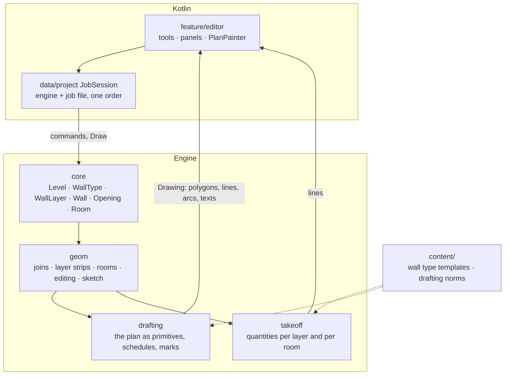
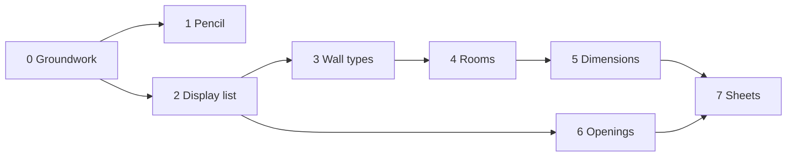

# Roadmap: plans like the architects draw

Eight slices take the editor from one-material walls to the sheets builders get from architects. Each slice is one decision, one schema step, engine code, a job-file version and a screen, and ships on its own.

The goal, the reference plans and the designs are described in [research/Chizma muharrirlari tajribasi.md](research/Chizma%20muharrirlari%20tajribasi.md). Screens G31–G46 are in the design canvas.

## Where the code stands

| Area | Today | What blocks the goal |
|---|---|---|
| Drawing | `drafting::draft` places everything on the plan; one `PlanPainter` paints the screen and the PDF (ADR 0013). The plans go out as PDF sheets at a standard scale: a frame, every room's sizes, the room and opening schedules, a legend and a title block | A sheet is A4 only; sizes on paper are ratios of the text height, not the СПДС offsets |
| Wall | A wall names a type made of layers; the plan hatches them and the take-off counts each (ADR 0014). The wall panel shows the location line. A type's layers take other thicknesses, and every wall of the type follows | A layer keeps the material its catalog template gave it; a layer cannot be added or taken out |
| Rooms | The spaces the walls close are found, named and drawn with their areas; a tap selects one (ADR 0015). A sheet lists them with their areas | A label may still lie under a door's swing in a room too small to move it |
| Dimensions | The plan's overall size outside; the selected room's clear sizes and a chain along each side with openings; a tap on a number types a new value; a partition goes across a room at a typed distance from one of its walls; a room is built from its clear size at a touched corner (ADR 0016) | A room built against an outer corner is not flush with it; a room cannot be turned off the plan's axes |
| Openings | A door hangs on either edge and opens to either side; openings of one size share a mark; a selected opening has its chain and can be centred; an opening takes a width, a height and a height over the floor of the builder's own; a sheet lists the marks with their sizes and counts (ADR 0017) | No two-leaf doors |
| Editor | `JobSession` talks to the engine, writes the job file and mirrors the model. `EditorViewModel` keeps the conversation with the builder and maps the model to an `EditorUiState` of four parts: the plan, the tools, the open panel and the estimate. The screen is split into tool bar, panels and number pads | The view model is still one class of about 1 700 lines |
| Tests | GoogleTest units with seeded random plans and strokes, Kotlin unit tests, three instrumented suites, one of the reference plans as a golden test of the drawing, of the take-off and of the job file | No screenshot tests; the benchmark is not run in CI |

## Target shape

Kotlin keeps three things: the conversation with the user (tool, digits, options), painting primitives it is handed, and files. Everything with a coordinate comes from the engine.

## Decisions to record first

Each is a one-way door, so each gets an ADR before its code.

| ADR | Decision | Reason |
|---|---|---|
| 0012 | A sketch becomes walls in the engine | Straightening is geometry; it must snap by the rules `aim` uses |
| 0013 | The engine drafts the plan, Kotlin paints it | One drawing for screen and PDF; label placement leaves Kotlin |
| 0014 | Wall types are job elements made of layers | A type edited once changes every wall of it; ops stay property-level |
| 0015 | Rooms are the spaces the walls close, named by an anchor | Areas follow the walls without a second model |
| 0016 | A dimension is a handle on the model | Tapping a size sends one command; joined walls follow |
| 0017 | Openings carry hinge and swing; marks are derived | A schedule that cannot drift from the plan |

### 0013: the display list

The engine answers a `Draw` query with a `Drawing` for one level.

| Primitive | Carries |
|---|---|
| Polygon | points, `Fill` (block, brick, insulation, partition, room tint, opening gap) |
| Line, Arc | points, `Stroke` (wall edge, window frame, door leaf, dimension, guide) |
| Text | kind (length, area, room name code, mark), value, anchor, angle |
| Handle | the element and, for a dimension, what editing it means |

- `Draw` names the level and how big the label text is on the plan: a line's height and a digit's width in plan millimetres. The engine uses them to place labels and drop the ones that do not fit. `Draw.sheet` says the drawing is for a sheet: every space gets its sizes.
- The sheet's size, its frame, the height of its text and the scales a plan is drawn at are in `content/catalog/sheet.json` (rule 5), read by the app that lays the page out. A plan is drawn at the largest of those scales it fits at, named in the title block: «М 1:100». Ticks and offsets stay ratios of the text height in `drafting`, on a sheet as on a screen. The СПДС offsets on paper, 10 mm to the first dimension line and 7 mm between lines, are open.
- One `PlanPainter` over `android.graphics.Canvas` serves Compose and the PDF. It maps `Fill` and `Stroke` to paints and formats numbers; it positions nothing.
- `Response.outlines` stays, for the plan's extent and the walls' lengths. `Response.openings` has no reader in the app any more.

### 0014: wall types and layers

| Element | Fields |
|---|---|
| `WallType` | `role`: exterior, bearing, partition |
| `WallLayer` | `type`, `position`, `function` (structure, insulation, facing, gap), `thickness`, `unit_length`, `unit_width`, `unit_height` |
| `Wall` | gains `type` and `mirrored` (layers run the other way) |

- A layer is its own element, so `Create`, `Delete` and `SetField` cover it and the job file gets a flat table.
- The name on screen is the role and the total thickness: «Наружная 410». No strings enter the op log.
- A layer's outline is the wall's joined footprint clipped to the layer's strip. `join_walls` does not change, and mitres come out per layer.
- The take-off measures layers the way it measures walls today. Role replaces the thickness test for load-bearing walls.
- A wall without a type is read as one structure layer of its own thickness and unit. `build_of` is the one path geometry, drawing and take-off read walls through, so an old job opens unchanged. A wall with a type stores no thickness and no unit.
- `content/catalog/wall_types.json` offers templates; the job stores sizes, as ADR 0008 does for units.

### 0015: rooms

- A space is a bounded face of a level's wall graph: joints of wall ends and the points where an end stands against a wall, as the joins read them. Its outline is the inner faces of its walls. Openings do not cut it, so a doorway never opens a room.
- What stands free inside a space, a wall or a closed group of walls, is an island: its footprint comes off the floor.
- `Room` is an element with `level`, `anchor` and `kind` (a code the app translates). The space that holds the anchor takes the name. A space without one is drawn with its area only.
- Two anchors in one space and an anchor in no space are issues.
- The spaces come from the engine's own code, not from Clipper2: topology on whole millimetres gives the same bits on every platform, and a T joint cannot leak one room into the next.

### 0016: dimensions

- The engine writes the sizes as lines and texts of the drawing: the plan's overall size outside, and for the space in focus its clear sizes and a chain along each side with openings. Offsets are ratios of the text height.
- A number is a handle: its text says what a typed value changes, and `SetDimension` sends the handle back with the value. An opening's width resizes it, a piece of wall moves the opening it leads to, a clear size moves one of its two walls.
- `geom::translate_wall` moves a wall across the plan with what is joined to it, as `resize_wall` does along it; `geom::set_distance` finds the move that puts two walls a clear distance apart.
- `geom::across` puts a partition from a wall to the opposite wall at a typed distance from a third: `AddWallAcross`, started from the room's panel.
- `geom::room_walls` builds a room from its clear size at a touched corner, reusing the walls already there: `AddRoomWalls`, started from the wall tool.

### 0012: the pencil

- `AddSketch` takes the stroke's points. `geom::straighten` finds its corners, lays each held leg where the stroke ran, closes a loop that ends near its start, pins corners to wall ends and then places each leg by the `aim` rules.
- A stroke is straightened when the finger lifts; there is no button.
- `Wall.exact` is false for a sketched wall until a length is typed or measured. Such lengths are written with «≈», and a pass over them asks each one in turn.
- The stroke under the finger is input echo, so Kotlin draws it.

## Slices

| # | Slice | Engine | Kotlin | Job file | Designs | Status |
|---|---|---|---|---|---|---|
| 0 | Groundwork | — | Split the editor files, `JobSession`, shared components, icon-only tool bar, tool options button | — | G31 bar, G43–G46 | built; shared components wait for a second feature |
| 1 | Pencil | `geom/sketch`, `AddSketch`, `Wall.exact` | Pencil tool, refine lengths | v5 | G39–G42 | built |
| 2 | Display list | `engine/drafting`, `Draw` | `PlanPainter`; delete placement code | — | — | built |
| 3 | Wall types | `WallType`, `WallLayer`, layer strips, take-off per layer | Type list, wall panel, location line | v6 | G32, G33 | built; a layer's thickness is edited, its material and the number of layers are not |
| 4 | Rooms | `geom/spaces`, `Room`, floors and room texts in `drafting` | Room labels, room panel | v7 | G31, G34 | built; a room's sizes come with slice 5 |
| 5 | Dimensions | Sizes in `drafting`, `SetDimension`, `translate_wall`, `set_distance`, `across`, `room_walls` | Tap a size, wall by distance, room tool | — | G35, G36 | built |
| 6 | Openings | hinge, swing, marks, `CenterOpening`, the selected opening's chain | Door panel | v8 | G37 | built |
| 7 | Sheets | `Draw.sheet`, room and opening schedules, marks clear of sizes | Frame, tables, legend, title block, PDF of plans | — | G38 | built; one storey to an A4 page, at the largest standard scale it fits at |

Slice 1 comes first because it is the smallest end-to-end change: it proves the recipe below before the larger slices use it. Columns, porch, stairs, tracing over a PDF, roof, facades and 3D follow slice 7.

### Slice 0 in detail

| Step | Result | Status |
|---|---|---|
| `data/project/JobSession` | One place sends commands and records the response, in order. It holds the mirrored model. The view model maps it to `UiState` | done |
| Split `EditorScreen.kt` | Tool bar, tool options, panels and number pads in files of their own, each under about 400 lines | done |
| Split `EditorUiState` | `PlanState`, `ToolState`, `PanelState`, `EstimateState`; a change to one part goes through `updatePlan`, `updateTools`, `updatePanel` or `updateEstimate` | done |
| `core/designsystem` | Round button, panel, inspector row, number pad, switch row | when a second feature needs them |
| Tool bar | Five icons, the chosen one filled; names in the tools sheet | done |
| Tool options | One movable button per screen; its rows come from the tool. It hides for a tool with nothing to choose. Its place is kept on the phone between runs | done |

No behaviour changes in this slice except the tool bar and the options button.

## Recipe for a slice

1. ADR, if the slice has a one-way door.
2. `schema/engine.fbs`: fields at the end, with defaults.
3. `engine/core`: element or field, `validate`, `ElementTraits`, command, ops.
4. `engine/geom` or `drafting`: pure functions with a stated precondition and order-independent results.
5. `engine/takeoff` and `content/`: quantities and the Luau rule.
6. `engine/bridge`: decode, encode, session test.
7. `android/engine-bridge`: command, model, encoder and decoder tests.
8. `android/data/project`: row, mapping, migration, exported schema, `MigrationTest`.
9. `android/feature/editor`: state, panel, strings in three languages, view model test.
10. Docs: `architecture.md`, module README, glossary.

Commits follow the order above: `docs(adr)`, `feat(engine)`, `feat(engine-bridge)`, `feat(data/project)!`, `feat(editor)`. Each builds and passes on its own.

A new element type touches the model tuple, the op variant, `Document::plan` and `apply`, the schema's `Element` and `Op` unions, both codecs, the Kotlin model and the job file. The checklist goes into `engine/core/README.md` with the first new element.

## Quality gates

| Gate | What it adds to today's CI |
|---|---|
| Golden jobs | `testdata/` holds the reference plans as jobs with expected wall lengths, room areas and take-off lines. `План3` must give 25,1, 13,5, 11,2 and 11,5 m². Built for `План3` as `drafting/tests/golden_plan3_test.cpp`: its walls, rooms and openings give those areas, the sheet's sizes and its opening schedule. Its take-off is checked in `bridge/tests/session_test.cpp`: laid from aerated blocks, the plan takes 734, 179 and 447 blocks, as counted by hand from the sheet with its openings and lintels. Jobs in `testdata/` are open |
| Property tests | Seeded random plans in GoogleTest: footprints and rooms tile the outline; `straighten` returns the walls a noisy stroke was drawn along. Built: `FindSpaces.WallsAndFloorsTileAnyGridOfRooms`, `Straighten.ShakyRoomsComeBackAsDrawn` |
| Bridge | Every new command and result in `session_test.cpp`, valid and corrupt |
| Job file | A migration test per version; an instrumented test that saves and reopens a golden job. Built: `GoldenJobTest` draws `План3` in the real engine on a device, reopens its file in another engine and gets the same model and the same sheet, number for number |
| Screens | Roborazzi images of `PlanPainter` on a fixed drawing and of each new panel. Not set up yet: the painter was checked by eye on the emulator and on a PDF |
| Speed | A benchmark derives joins, layers, rooms and the drawing for 500 walls; the budget is one frame. Built as `engine/tools/bench`: 511 walls with as many openings and 240 rooms take 2,0 ms for the screen and 150 ms for a sheet on a desktop core; a house of 60 walls 0,2 ms. `otves_bench 8.3` fails over a frame; CI does not run it yet |
| Device | The emulator checklist from the last change: draw, type a length, undo, refuse |

Rules that already hold stay: clang-tidy over every file, ASan and TSan presets, Spotless, lint, a green run after every push. Roborazzi, Robolectric and a benchmark library are new dependencies; each is pinned at its latest stable version when its slice starts.

## Risks

| Risk | Answer |
|---|---|
| Text width is unknown to the engine | Per-character width factors in `drafting`; the painter never moves a label, it may only hide one |
| `Draw` on every drag frame | Derive one level, not the job; a screen's drawing writes the selected opening's mark only; the benchmark guards it |
| Walls that cross without being split read as one room on both sides | The join reports the crossing as an overlap; a property test checks that walls and floors tile random plans |
| Layer order on a wall drawn the other way | `mirrored`, set by the room and pencil tools from the loop's direction |
| Marks renumber when a size is added | Marks follow the oldest opening of each size |
| Scope | A slice ships alone; nothing waits for slice 7 |

## Open question

Are room areas shown to 0,1 m², as the one-sheet plans do, or 0,01 m², as the АР set does? The engine gives areas in cm²; the app writes 0,1 m² for now.
