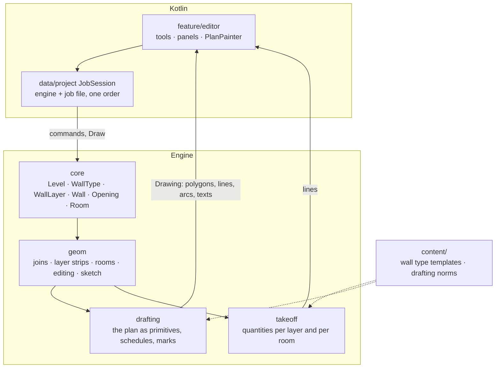
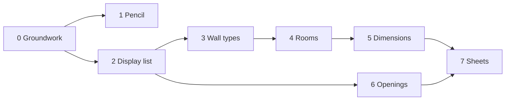

# Roadmap: plans like the architects draw

Eight slices take the editor from one-material walls to the sheets builders get from architects. Each slice is one decision, one schema step, engine code, a job-file version and a screen, and ships on its own.

The goal, the reference plans and the designs are described in [research/Chizma muharrirlari tajribasi.md](research/Chizma%20muharrirlari%20tajribasi.md). Screens G31–G46 are in the design canvas.

## Where the code stands

| Area | Today | What blocks the goal |
|---|---|---|
| Drawing | `PlanCanvas.dimension()` and `opening()` place labels and door swings; `EstimatePdf.length()` repeats it | Geometry in Kotlin, twice. Rule 1 is broken the way ADR 0011 found it for editing |
| Wall | One thickness, one masonry unit, a location line the app never shows | No layers, no hatches, no take-off for insulation or facing brick |
| Rooms | None | No names, areas or room schedule |
| Dimensions | One length per wall, along its location line | Plans give clear room sizes and chains along walls |
| Openings | Offset, size, sill, kind | No hinge side, swing, marks or schedule |
| Editor | `EditorViewModel` about 1 000 lines: it mirrors the model and talks to the engine and the job file. The screen is split into tool bar, panels and number pads | Every feature still lands in the view model |
| Tests | GoogleTest units, Kotlin unit tests, three instrumented suites | No golden jobs, no property tests, no screenshot tests, no benchmark |

## Target shape

Kotlin keeps three things: the conversation with the user (tool, digits, options), painting primitives it is handed, and files. Everything with a coordinate comes from the engine.

## Decisions to record first

Each is a one-way door, so each gets an ADR before its code.

| ADR | Decision | Reason |
|---|---|---|
| 0012 | A sketch becomes walls in the engine | Straightening is geometry; it must snap by the rules `aim` uses |
| 0013 | The engine drafts the plan, Kotlin paints it | One drawing for screen and PDF; label placement leaves Kotlin |
| 0014 | Wall types are job elements made of layers | A type edited once changes every wall of it; ops stay property-level |
| 0015 | Rooms are holes in the walls, named by an anchor | Areas follow the walls without a second model |
| 0016 | A dimension is a handle on the model | Tapping a size sends one command; joined walls follow |
| 0017 | Openings carry hinge and swing; marks are derived | A schedule that cannot drift from the plan |

### 0013: the display list

The engine answers a `Draw` query with a `Drawing` for one level.

| Primitive | Carries |
|---|---|
| Polygon | points, `Fill` (block, brick, insulation, partition, room tint, opening gap) |
| Line, Arc | points, `Stroke` (wall edge, window frame, door leaf, dimension, guide) |
| Text | kind (length, area, room name code, mark), value, anchor, angle |
| Handle | the element and, for a dimension, what editing it means |

- `Draw` names the level, the purpose (screen or sheet) and how many plan millimetres one text height covers. The engine uses it to place labels and drop the ones that do not fit.
- Tick sizes, text heights and offsets of SPDS go to `content/norms/drafting.luau` (rule 5).
- One `PlanPainter` over `android.graphics.Canvas` serves Compose and the PDF. It maps `Fill` and `Stroke` to paints and formats numbers; it positions nothing.
- `Response.outlines` and `Response.openings` stay in the schema and stop being filled once the painter reads the drawing.

### 0014: wall types and layers

| Element | Fields |
|---|---|
| `WallType` | `role`: exterior, bearing, partition |
| `WallLayer` | `type`, `position`, `function` (structure, insulation, facing, gap), `thickness`, `unit_length`, `unit_width`, `unit_height` |
| `Wall` | gains `type` and `mirrored` (layers run the other way) |

- A layer is its own element, so `Create`, `Delete` and `SetField` cover it and the job file gets a flat table.
- The name on screen is the role and the total thickness: «Наружная 400». No strings enter the op log.
- A layer's outline is the wall's joined footprint clipped to the layer's strip. `join_walls` does not change, and mitres come out per layer.
- The take-off measures layers the way it measures walls today. Role replaces the thickness test for load-bearing walls.
- A job without types gets them when it opens: one type per distinct thickness and unit, as one op group. No second code path stays behind. `Wall.thickness` and `Wall.unit_*` are deprecated, not removed.
- `content/catalog/wall_types.json` offers templates; the job stores sizes, as ADR 0008 does for units.

### 0015: rooms

- A room is a hole in the union of a level's wall footprints. Openings do not cut footprints, so a doorway never opens a room.
- `Room` is an element with `level`, `anchor` and `kind` (a code the app translates). The hole that holds the anchor takes the name. A hole without one is drawn with its area only.
- Two anchors in one hole and an anchor in no hole are issues.
- The ADR decides between Clipper2 (BSL-1.0, in vcpkg) and own code for the union. Dangling walls, columns and sharp corners argue for the library.

### 0016: dimensions

- A dimension primitive carries a handle: wall length, clear distance between two walls, opening width, opening distance from a corner.
- `SetDistance` moves one of two walls so the faces stand a typed distance apart. `geom::translate_wall` returns the end moves, as `resize_wall` does.
- `geom::across` gives a partition from a wall face to the opposite wall at a typed distance. `geom::room_walls` gives the walls of a room entered by clear size and reuses walls already there.

### 0012: the pencil

- `AddSketch` takes the stroke's points. `geom::straighten` finds its corners, lays each held leg where the stroke ran, closes a loop that ends near its start, pins corners to wall ends and then places each leg by the `aim` rules.
- A stroke is straightened when the finger lifts; there is no button.
- `Wall.exact` is false for a sketched wall until a length is typed or measured. Such lengths are written with «≈», and a pass over them asks each one in turn.
- The stroke under the finger is input echo, so Kotlin draws it.

## Slices

| # | Slice | Engine | Kotlin | Job file | Designs | Status |
|---|---|---|---|---|---|---|
| 0 | Groundwork | — | Split the editor files, `JobSession`, shared components, icon-only tool bar, tool options button | — | G31 bar, G43–G46 | in part |
| 1 | Pencil | `geom/sketch`, `AddSketch`, `Wall.exact` | Pencil tool, refine lengths | v5 | G39–G42 | built |
| 2 | Display list | `engine/drafting`, `Draw` | `PlanPainter`; delete placement code | — | — | next |
| 3 | Wall types | `WallType`, `WallLayer`, layer strips, take-off per layer | Type list, wall panel, location line | v6 | G32, G33 | |
| 4 | Rooms | `geom/rooms`, `Room` | Room labels, room panel | v7 | G31, G34 | |
| 5 | Dimensions | chains, `SetDistance`, `across`, `room_walls` | Tap a size, wall by distance, room tool | — | G35, G36 | |
| 6 | Openings | hinge, swing, marks, schedules | Door panel | v8 | G37 | |
| 7 | Sheets | sheet purpose in `Draw`, schedules | Frame, tables, legend, PDF | — | G38 | |

Slice 1 comes first because it is the smallest end-to-end change: it proves the recipe below before the larger slices use it. Columns, porch, stairs, tracing over a PDF, roof, facades and 3D follow slice 7.

### Slice 0 in detail

| Step | Result | Status |
|---|---|---|
| `data/project/JobSession` | One place sends commands and records the response, in order. It holds the mirrored model. The view model maps it to `UiState` | with slice 2 |
| Split `EditorScreen.kt` | Tool bar, tool options, panels and number pads in files of their own, each under about 400 lines | done |
| Split `EditorUiState` | `PlanState`, `ToolState`, `PanelState`, `EstimateState` | with slice 2 |
| `core/designsystem` | Round button, panel, inspector row, number pad, switch row | when a second feature needs them |
| Tool bar | Five icons, the chosen one filled; names in the tools sheet | done |
| Tool options | One movable button per screen; its rows come from the tool. It hides for a tool with nothing to choose. Position and options persist per device | done, but the position lasts only while the app lives |

No behaviour changes in this slice except the tool bar and the options button.

## Recipe for a slice

1. ADR, if the slice has a one-way door.
2. `schema/engine.fbs`: fields at the end, with defaults.
3. `engine/core`: element or field, `validate`, `ElementTraits`, command, ops.
4. `engine/geom` or `drafting`: pure functions with a stated precondition and order-independent results.
5. `engine/takeoff` and `content/`: quantities and the Luau rule.
6. `engine/bridge`: decode, encode, session test.
7. `android/engine-bridge`: command, model, encoder and decoder tests.
8. `android/data/project`: row, mapping, migration, exported schema, `MigrationTest`.
9. `android/feature/editor`: state, panel, strings in three languages, view model test.
10. Docs: `architecture.md`, module README, glossary.

Commits follow the order above: `docs(adr)`, `feat(engine)`, `feat(engine-bridge)`, `feat(data/project)!`, `feat(editor)`. Each builds and passes on its own.

A new element type touches the model tuple, the op variant, `Document::plan` and `apply`, the schema's `Element` and `Op` unions, both codecs, the Kotlin model and the job file. The checklist goes into `engine/core/README.md` with the first new element.

## Quality gates

| Gate | What it adds to today's CI |
|---|---|
| Golden jobs | `testdata/` holds the reference plans as jobs with expected wall lengths, room areas and take-off lines. `План3` must give 25,1, 13,5, 11,2 and 11,5 m² |
| Property tests | Seeded random plans in GoogleTest: footprints and rooms tile the outline; `straighten` returns the walls a noisy stroke was drawn along |
| Bridge | Every new command and result in `session_test.cpp`, valid and corrupt |
| Job file | A migration test per version; an instrumented test that saves and reopens a golden job |
| Screens | Roborazzi images of `PlanPainter` on a fixed drawing and of each new panel |
| Speed | A benchmark derives joins, layers, rooms and the drawing for 500 walls; the budget is one frame |
| Device | The emulator checklist from the last change: draw, type a length, undo, refuse |

Rules that already hold stay: clang-tidy over every file, ASan and TSan presets, Spotless, lint, a green run after every push. Roborazzi, Robolectric, a benchmark library and Clipper2 are new dependencies; each is pinned at its latest stable version when its slice starts.

## Risks

| Risk | Answer |
|---|---|
| Text width is unknown to the engine | Per-character width factors in `drafting`; the painter never moves a label, it may only hide one |
| `Draw` on every drag frame | Derive one level, not the job; the benchmark guards it |
| Union of footprints leaves slivers | Integer coordinates in the union; property tests on random plans |
| Layer order on a wall drawn the other way | `mirrored`, set by the room and pencil tools from the loop's direction |
| Marks renumber when a size is added | Marks follow the oldest opening of each size |
| Scope | A slice ships alone; nothing waits for slice 7 |

## Open question

Are room areas shown to 0,1 m², as the one-sheet plans do, or 0,01 m², as the АР set does? Slice 4 starts with 0,1 m².
