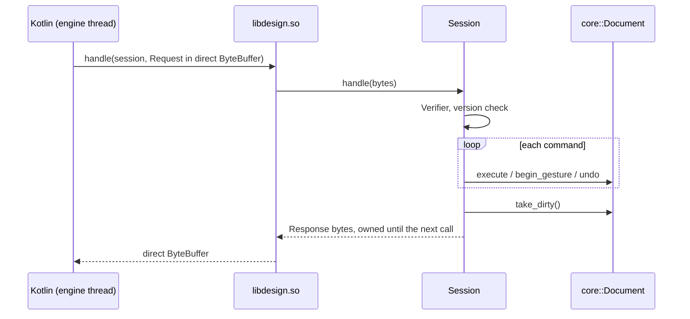

# engine/bridge

The engine's door to the Kotlin app: a `Session` that runs FlatBuffers requests from `schema/engine.fbs` against one document, and the JNI functions of `libdesign.so` that carry them ([ADR 0006](../../docs/adr/0006-engine-bridge-protocol.md)).

## Entry points

| API | Use |
|---|---|
| `Session(device)` | One open job; the device id stamps its operations |
| `Session::handle(request)` | Runs a `Request`, returns a `Response` valid until the next call |
| `NativeEngine.create(high, low)` | JNI: a session handle for a device id |
| `NativeEngine.handle(session, buffer, size)` | JNI: one request in, one direct `ByteBuffer` out, or null for a bad handle or buffer |
| `NativeEngine.destroy(session)` | JNI: frees the session |

## Response

| Field | Content |
|---|---|
| `results` | One per command, in order: `ErrorCode`, an English message for logs, the created element's id, the element a `Pick` found, where an `Aim` or `AimMeasured` says a wall would end, the `Drawing` a `Draw` asked for |
| `changes` | Each changed level, wall or opening with its full value, or with no value when deleted; sorted by id |
| `can_undo`, `can_redo` | For the toolbar |
| `outlines` | Every wall's joined plan outline in metres, level by level; only when the model or the content changed |
| `takeoff`, `takeoff_error` | Material lines from the loaded rules, or why they could not run; absent until `LoadContent` |

`Pick`, `Aim`, `AimMeasured` and `Draw` are questions: they read the model and change nothing. `Draw` answers with one level as a display list from `drafting::draft` ([ADR 0013](../../docs/adr/0013-the-engine-drafts-the-plan.md)); sent after the commands of a request, it shows what they did. `SetWallLength` asks `geom::resize_wall` what moves and runs it as `MoveWallEnd` commands in one undo step ([ADR 0011](../../docs/adr/0011-plan-editing-in-the-engine.md)); it also makes the wall exact.

`AddSketch` asks `geom::straighten` what walls a stroke means and runs them as `AddWall` commands in one undo step, each wall not exact ([ADR 0012](../../docs/adr/0012-a-sketch-becomes-walls-in-the-engine.md)). Both check every command before running the first, so a refusal changes nothing.

`LoadContent` carries the Luau norms and rules from the app's assets. A bundle that does not compile fails that command and keeps the content that ran before.

A request that fails the `Verifier` or names another version gets a single `CorruptData` or `UnsupportedVersion` result and changes nothing.

## Android build

`android/engine-bridge` builds the `otves_design` target with the engine's own `CMakeLists.txt`: vcpkg as the toolchain, the arm64-android triplet, and NDK r30 chained in from the `ANDROID_NDK` that Gradle passes. The AAR carries `jni/arm64-v8a/libdesign.so`.

On the Kotlin side, `generateSchemaJava` downloads flatc 25.2.10 (SHA-256 pinned, matching `flatbuffers-java`) and generates `uz.otves.schema`. `EngineSession.send(commands)` encodes `EngineCommand`s, runs them and decodes an `EngineResponse` of typed results and element changes. `EngineSessionTest` runs that path against the real `libdesign.so` on an arm64 device or emulator.

## Invariants

- A session is used from one thread. JNI functions and `handle` are `noexcept`; an exception becomes an `Internal` result.
- Commands run in order. One that fails changes nothing, and the rest still run.
- Enums map explicitly both ways. An unknown value from a newer app is `CorruptData`, never a wrong value.
- `flatc` generates the C++ code at build time from `schema/engine.fbs`; nothing generated is committed.
