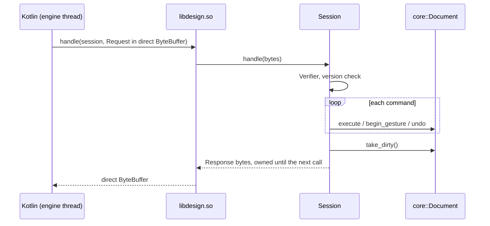

# engine/bridge

The engine's door to the Kotlin app: a `Session` that runs FlatBuffers requests from `schema/engine.fbs` against one document, and the JNI functions of `libdesign.so` that carry them ([ADR 0006](../../docs/adr/0006-engine-bridge-protocol.md)).

## Entry points

| API | Use |
|---|---|
| `Session(device)` | One open job; the device id stamps its operations |
| `Session::handle(request)` | Runs a `Request`, returns a `Response` valid until the next call |
| `NativeEngine.create(high, low)` | JNI: a session handle for a device id |
| `NativeEngine.handle(session, buffer, size)` | JNI: one request in, one direct `ByteBuffer` out, or null for a bad handle or buffer |
| `NativeEngine.destroy(session)` | JNI: frees the session |

## Response

| Field | Content |
|---|---|
| `results` | One per command, in order: `ErrorCode`, an English message for logs, the created element's id |
| `changes` | Each changed level, wall or opening with its full value, or with no value when deleted; sorted by id |
| `can_undo`, `can_redo` | For the toolbar |

A request that fails the `Verifier` or names another version gets a single `CorruptData` or `UnsupportedVersion` result and changes nothing.

## Invariants

- A session is used from one thread. JNI functions and `handle` are `noexcept`; an exception becomes an `Internal` result.
- Commands run in order. One that fails changes nothing, and the rest still run.
- Enums map explicitly both ways. An unknown value from a newer app is `CorruptData`, never a wrong value.
- `flatc` generates the C++ code at build time from `schema/engine.fbs`; nothing generated is committed.
