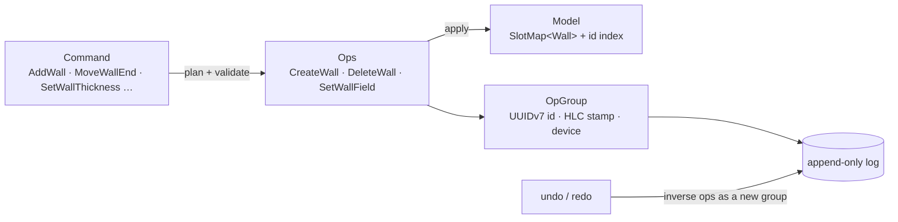

# engine/core

The model of one part, the commands that change it, and the operation log that undo, history and sync read.

## Entry points

| API | Use |
|---|---|
| `Document::execute(Command)` | Validate and apply one command; on error nothing changes |
| `begin_gesture()` / `end_gesture()` | Fold every frame of a drag into one group |
| `undo()` / `redo()` | Append a group with inverse or repeated ops |
| `log()` | Groups to persist; read from the last stored index |
| `take_dirty()` | Sorted ids of elements to rebuild |
| `model()` | Read-only view of walls |

## Invariants

- Only `Document` mutates the model, and only by applying ops.
- The log only grows. Undo and redo append groups whose `origin` names the group they reverse.
- In a gesture each field keeps its first `before` and last `after`; a gesture that ends where it began records nothing.
- Stamps from one document grow strictly, even if the wall clock steps back.
- Lengths are integer millimetres (`Mm`); plan coordinates run x right, y up from the part's origin.
