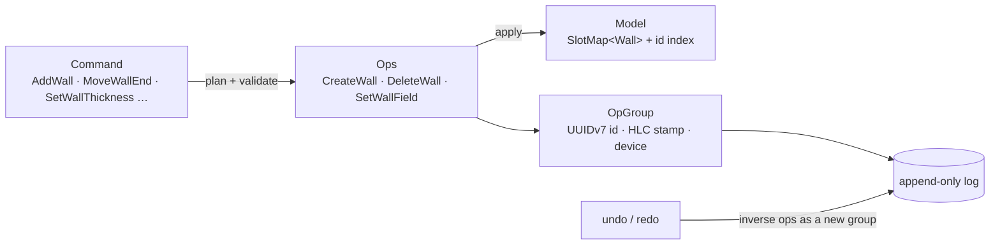

# engine/core

The model of one part, the commands that change it, and the operation log that undo, history and sync read.

## Entry points

| API | Use |
|---|---|
| `Document::execute(Command)` | Validate and apply one command; on error nothing changes |
| `begin_gesture()` / `end_gesture()` | Fold every frame of a drag into one group |
| `undo()` / `redo()` | Append a group with inverse or repeated ops |
| `log()` | Groups to persist; read from the last stored index |
| `take_dirty()` | Sorted ids of elements to rebuild |
| `model()` | Read-only view of walls |
| `build_of(model, wall)` | What a wall is built of: the role of its type and its layers from the outer face in. A wall with no type is one structure layer of its own thickness and unit (ADR 0014) |
| `geometric(wall, build)` | The wall as geometry reads it: the layers' total thickness, no type |

## Invariants

- Only `Document` mutates the model, and only by applying ops.
- The log only grows. Undo and redo append groups whose `origin` names the group they reverse.
- In a gesture each field keeps its first `before` and last `after`; a gesture that ends where it began records nothing.
- Stamps from one document grow strictly, even if the wall clock steps back.
- Lengths are integer millimetres (`Mm`); plan coordinates run x right, y up from the part's origin.
- A wall with a type stores thickness 0 and no unit; setting either on it is refused with `kTypeDecides`.
- A layer names a type that exists, and a wall a type that has layers. A saved job that breaks this does not open.
- The outer face of a wall is its right face, looking from start to end, and its left when `mirrored` is set.
- A room keeps the point the user gave. Whether a space lies under it is derived, because the walls may change later (ADR 0015).

## Adding an element type

`Room` (ADR 0015) is the last one added; follow it file by file.

| Step | Where |
|---|---|
| The value, `validate`, the field enum, `get_field`, `set_field`, `ElementTraits` | `include/otves/core/<type>.h`, `src/<type>.cpp` |
| A store in the model's tuple | `model.h` |
| `Create`, `Delete` and `SetField` in the `Op` variant; command kinds at the end of the enum | `op.h` |
| Commands and their kinds | `command.h`, `command.cpp` |
| Planning each command; what goes with a removed parent; the saved elements, their ids and parents | `document.h` (`Snapshot`), `document.cpp` (`plan`, `remove_level`, `load`, `collect_ids`) |
| The table, the `Element` and `Op` unions, command and kind codes, appended | `schema/engine.fbs` |
| Decode, encode, the snapshot, `encode_change`; the op and its field codes | `bridge/src/convert.*`, `bridge/src/oplog.cpp` |
| The Kotlin value, commands, encoder and decoder | `android/engine-bridge` |
| A row, its mapping, the DAO, a new file version with a migration test | `android/data/project` |
| The mirrored map | `JobSession` |
