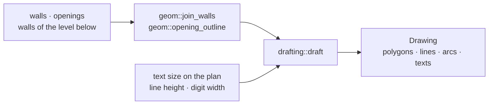

# engine/drafting

Turns one level into a display list: what to draw and where, in plan metres. A painter gives it colours and line widths; nothing in it is moved afterwards ([ADR 0013](../../docs/adr/0013-the-engine-drafts-the-plan.md)).

## Entry point

| API | Use |
|---|---|
| `draft(plan, text)` | The level as a `Drawing`. `text` is how big the painter's label text is on the plan at its zoom |

## What is drawn

| Part | Primitives |
|---|---|
| Walls of the level below | An outline each, with no element: they cannot be picked from above |
| Wall | Its joined outline, filled as masonry or as a wall with no material yet |
| Opening | The gap through its wall and two jambs |
| Window | The gap, its two faces and the glazing line down the middle of the wall |
| Door | The gap, the leaf standing open at right angles on the wall's left face, hinged at the near end, and its swing |
| Wall length | A number beside the wall and along it, marked when nobody has typed or measured it |

Painting order is the order of the lists: polygons, lines, arcs, texts. Walls come before gaps, so a gap cuts the wall under it.

## Where a length is written

| Rule | Value |
|---|---|
| First place | The middle of the wall, by its left face, a quarter of a text height clear |
| Next places | The other face, then 0,3 and 0,7 of the way along, each by the left face first |
| A place is taken | When the text's middle or either end lies on another wall, or nearer another length than the text is wide |
| No free place | The first one is used |
| Left out | A text wider than four fifths of its wall |
| Reading | From the left; on an upright wall from the bottom up |

Text width is the count of digits times the width of one. «≈» and its space count as two digits.

## Invariants

- Pure: the same input gives the same list, in the order of element ids. Input order does not matter.
- Only `+ − × ÷ √` on coordinates, as in `geom`. Angles are left to the painter: an arc is a centre and two points, a text has a unit direction.
- Input walls pass `validate()` and have unique ids.
