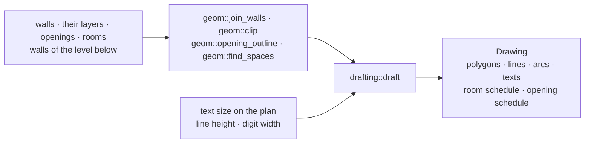

# engine/drafting

Turns one level into a display list: what to draw and where, in plan metres. A painter gives it colours and line widths; nothing in it is moved afterwards ([ADR 0013](../../docs/adr/0013-the-engine-drafts-the-plan.md)).

## Entry point

| API | Use |
|---|---|
| `draft(plan, text)` | The level as a `Drawing`. `text` is how big the painter's label text is on the plan at its zoom |
| `mark_openings(openings)` | The mark of each opening of a job: one number for each kind, width and height, in the order of the oldest opening of each size |
| `list_openings(openings)` | The job's opening schedule: each mark once, with its size and how many openings have it; windows, doors, then empty openings, by number |

## Screen and sheet

`Plan.sheet` says what the drawing is for. The schedules go out either way: `Drawing.rooms` lists the level's spaces in reading order, from the top of the plan down and from the left, and `Drawing.openings` the job's marks.

| | Screen | Sheet |
|---|---|---|
| Room sizes | Of the space in focus, in place of its name | Of every space, beside its name |
| Their stroke | `kChain`, the colour of what is selected | `kDimension`, ink |
| Chain of an opening | Of the selected opening, when no space is in focus | One for each opening: a wall between two rooms is sized in the wider of them |
| A room's label | At its label point | Written after the sizes, where they leave room for it |
| Length of a wall round a space | Until somebody has typed or measured it | Never: the space's sizes say it |

## Sizes on a sheet

| Rule | Value |
|---|---|
| Order | Rooms from the widest to the narrowest, by the shorter stretch through the label point; a corridor comes last |
| A side whose openings all stand in a chain already | Gets no chain: the room across the wall has it |
| A clear size | 2,6 text heights from the top, or the left; further in by 1,3 while it would run through a number |
| No room that way | By the wall itself, 1,2 text heights in, if no chain runs there and it strikes no number; else through the label point |
| A label on a number | Moves across its line by half a text height at a time, either way, to the nearest place where it lies on the floor and meets no text; else it stays |

`tests/golden_plan3_test.cpp` drafts one of the architects' sheets, «План3», and checks the room areas written on it, its sizes, its opening schedule and that no text lies on another.

## What is drawn

| Part | Primitives |
|---|---|
| Walls of the level below | An outline each, with no element: they cannot be picked from above |
| Space | Its floor, the largest first, so a room standing free in another is painted over it; it names its room, or nothing when no room names it ([ADR 0015](../../docs/adr/0015-rooms-are-spaces-the-walls-close.md)) |
| Wall | Its joined outline, filled as masonry or as a wall with no material yet |
| Wall of several layers | Each layer's part of the outline with a fill for what it does: structure, facing, insulation, none for a gap; then the outline with no fill, the polygon a painter marks when the wall is selected ([ADR 0014](../../docs/adr/0014-wall-types-are-job-elements-made-of-layers.md)) |
| Opening | The gap through its wall and two jambs |
| Window | The gap, its two faces and the glazing line down the middle of the wall |
| Door | The gap, the leaf standing open at right angles on the edge it hangs on and the face it opens to, and its swing ([ADR 0017](../../docs/adr/0017-openings-carry-hinge-and-swing-marks-are-derived.md)) |
| Mark | Beside each opening that has one and along its wall; the number goes out with a kind that names windows, doors or empty openings |
| Wall length | A number beside the wall and along it, marked when nobody has typed or measured it |
| Room | Its name, as its kind's code, over its floor area in cm²; the area alone in a space with no name |

Painting order is the order of the lists: polygons, lines, arcs, texts. Floors come before walls and walls before gaps, so a gap cuts the wall under it.

## Where a length is written

| Rule | Value |
|---|---|
| First place | The middle of the wall, by its left face, a quarter of a text height clear |
| Next places | The other face, then 0,3 and 0,7 of the way along, each by the left face first |
| A place is taken | When the text's middle or either end lies on another wall, or the text comes within a quarter of a text height of one written before it: a room's name or area, a size, another length |
| No free place | The first one is used |
| Left out | A text wider than four fifths of its wall |
| Reading | From the left; on an upright wall from the bottom up |

Text width is the count of digits times the width of one. «≈» and its space count as two digits.

## Where a mark is written

| Rule | Value |
|---|---|
| Along the wall | By the middle of the opening |
| First place | A text height from the face a leaf does not open to, to the mark's middle |
| Next places | The same by the other face; then 1,9 and 3 text heights from each face: past a chain whose numbers stand on the wall's side of it, and past the numbers of one whose numbers stand beyond it |
| A place is taken | When the mark's box meets a text written before it, or a dimension line, a tick, a door's leaf or its swing runs through it |
| No place is clear of all that | The nearest that is clear of the texts and the dimension lines |
| No such place either | The first one is used |
| Reading | As a length: from the left; on an upright wall from the bottom up |

A mark is taken to be five digits wide.

## Where a room is written

| Rule | Value |
|---|---|
| Across the plan | The middle of the widest stretch of floor at the height of the floor's centre of area |
| Up the plan | The middle of the stretch of floor through that point |
| Beside a corner that stands into the room | Where the floor across the plan is another stretch at that height, the middle of that one |
| Direction | Along x; up the plan in a space narrower than eight digits and taller than it is wide |
| Lines | The name half a text height to one side of the point, the area half to the other |
| A space lower than two lines | The area alone; lower than one line, nothing |
| Room for the text | Four fifths of the stretch it lies along goes out as `fit`: the painter knows how wide a name is in the builder's language, and leaves out a text that is wider |
| A door opens over it | The label moves along its line to the middle of the longest part of the stretch that no leaf sweeps, when that part has room for it: 16 digits for a name, 7 for an area alone. Otherwise it stays |

Rooms are written before wall lengths, so a length keeps clear of them.

## Sizes

Dimension lines, ticks and numbers are lines and texts of the drawing ([ADR 0016](../../docs/adr/0016-a-dimension-is-a-handle-on-the-model.md)). Their offsets are ratios of the text height, so they read the same at every zoom.

| Size | Line | Number |
|---|---|---|
| Overall, once the walls close a space | Two text heights outside the plan's outer faces: across the top and up the left side, with a line out to it from each corner | Over the line; no handle |
| Clear size of the space in focus | Across, 2,6 text heights under the top of the space; up, 2,6 from its left. A line that would run through a number goes 1,3 further in at a time; in a low or narrow space it runs through the middle | Over the line; names the wall at each end, so a typed value moves one of them |
| Chain along a side with openings | 1,2 text heights inside the wall's face, a tick at every corner and opening edge | A piece of wall leads to the next opening, the last one back to the opening before it; an opening's width is its own |
| A number wider than nine tenths of its piece | — | Left out |

A wall round a space has no length of its own once it was typed or measured. The space in focus has its sizes in place of its name and area. A selected opening has the chain of the side it is in: the side a door opens to, where there is one.

## Invariants

- Pure: the same input gives the same list, in the order of element ids. Input order does not matter.
- Only `+ − × ÷ √` on coordinates, as in `geom`. Angles are left to the painter: an arc is a centre and two points, a text has a unit direction.
- Input walls pass `validate()` and have unique ids.
