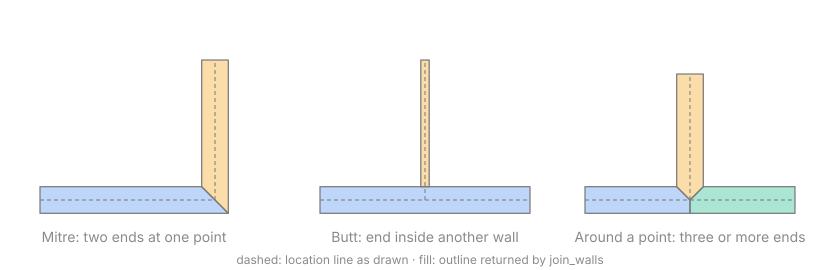
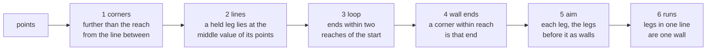
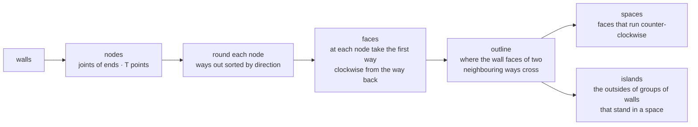

# engine/geom

Pure geometry over wall parameters: plan outlines in metres, with corners and junctions joined. The same input gives the same output bits on every platform.

## Entry points

| API | Use |
|---|---|
| `join_walls(walls)` | Outlines of all walls on one level, sorted by id; junctions where walls meet (corners, T, several walls at a point), sorted by point; join issues |
| `signed_area(outline)` | Area in m², positive for a counter-clockwise outline |
| `hit_wall(walls, at, reach)` | The wall nearest to a plan point within a reach, and how far along its location line the point lies |
| `hit_opening(openings, at, reach)` | The opening nearest to a plan point within a reach |
| `opening_outline(wall, opening)` | The rectangle an opening cuts through its wall on the plan, face to face |
| `aim(walls, below, touch)` | Where a wall being drawn would end under the finger, its length, the wall ends it lined up with and whether it meets the plan there |
| `aim(walls, measured)` | Where a wall of a typed length ends, turning left, straight or right from the wall before it |
| `resize_wall(walls, wall, length, fixed)` | Every wall end that moves when a wall gets a length, so what is joined stays joined |
| `translate_wall(walls, wall, by)` | Every wall end that moves when a wall goes across the plan without turning, so what is joined stays joined |
| `set_distance(walls, facing, distance)` | The same for the move that puts two walls side by side a clear distance apart, face to face |
| `across(walls, across)` | Where a wall goes that crosses the space holding a point, a clear distance from the wall that bounds the space on one hand of it: from the wall it meets on one side to the one on the other, along its own nearer face |
| `straighten(walls, below, sketch, like)` | The walls a stroke drawn with a finger means: corners found, legs laid on the axes, a loop closed, joined to the plan as `aim` joins a wall |
| `runs_clockwise(legs)` | Whether a sketch's legs enclose their area clockwise, so its outside is on the left of each leg |
| `layer_strips(wall, thicknesses)` | The strip of each layer across a wall, in metres left of its location line, from the outer face in |
| `clip(wall, outline, strip)` | The part of a wall's joined outline that lies in one strip |
| `find_spaces(walls)` | The spaces the walls of a level close: each with its outline along the inner faces of its walls, the islands standing free in it, its floor area and its perimeter |
| `holds(space, point)` | Whether a point lies on a space's floor: inside its outline and outside its islands |
| `sides_of(space, walls)` | The sides of a space: each a stretch of one wall's face, with where it lies along that wall |
| `span_on(side, opening)` | The stretch of a side an opening of its wall takes |
| `name_spaces(spaces, anchors)` | The room that names each space, by the anchor it holds; anchors in no space and second anchors in one space as issues |

## Joins

| Case | Result |
|---|---|
| Two ends at one point | Faces meet at a mitre (угловое сопряжение) |
| Three or more ends at one point | Each outline runs through the point, so the walls tile it with no gap |
| Ends inside another wall, at most one on each side | Cut back to that wall's face (примыкание); the other wall stays whole |
| Two walls continuing in a straight line | Both ends square, so walls of different thickness step |
| Mitre longer than `kMaxMitre` (10) thicknesses | Ends square, issue `kSharpAngle` |
| Two walls along one line from one point, or a wall inside another | Issue `kOverlap` |
| Two ends inside a wall from one side | Issue `kOverlap` |
| Walls crossing away from their ends | Issue `kOverlap`; split at the crossing, they join as four ends at one point |

## Editing

Editing reads the walls as a graph by the definition the joins use ([ADR 0011](../../docs/adr/0011-plan-editing-in-the-engine.md)): ends at one point are a joint, and an end inside another wall's body stands against that wall.

| Question | Answer |
|---|---|
| A touch near a wall end, of this level or the one below | That end |
| A touch elsewhere | The wall turns onto the nearer axis, always with the 90° lock and otherwise within about 6° of it; each free coordinate lines up with a wall end within reach or falls on the grid |
| A touch on or beside a wall's body | The point moves onto that wall's line, so the new wall meets it along its length |
| A typed length for a wall | Its fixed end stays and its far joint moves along it. Unless one is named, the fixed end is the one joined to other walls when the other is free, so a partition grows from the wall it stands against; else the start. A wall at a moving point stretches if it runs along the move and otherwise goes whole, with the ends standing against it; a wall reaching the fixed end turns about it |
| A move of a wall across the plan | Both its ends go, and what stands against it. A wall the move keeps on its own line, to the millimetre, stretches; any other wall with a moving point on it moves whole |
| A clear distance for two walls side by side | One of them moves across the plan until its face stands that far from the other's ([ADR 0016](../../docs/adr/0016-a-dimension-is-a-handle-on-the-model.md)) |
| A length or a move that would make a joined wall vanish or turn back, or leave a wall end off the wall it stands against | Refused with `kBreaksJoin`; nothing moves |

## Sketches

A stroke is read in six steps ([ADR 0012](../../docs/adr/0012-a-sketch-becomes-walls-in-the-engine.md)). The reach is how far from the finger still counts as touched, in plan millimetres at the zoom the stroke was drawn at.

| Stroke | Walls |
|---|---|
| A rough loop | The room, closed on its first corner; begun in the middle of a side, that side is still one wall |
| Rounded corners | Walls where the stroke ran, not where the corners were cut |
| A line that bows | One wall |
| From a wall to a wall | A partition meeting both along their length |
| Ending near a wall end | A wall to that end; the corner before it moves so the wall stays on its axis |
| A tap, or a stroke within reach of its first point | Refused with `kZeroLength` |

## Layers

A layer is a strip of its wall's joined outline ([ADR 0014](../../docs/adr/0014-wall-types-are-job-elements-made-of-layers.md)). Walls are joined as solid walls of the layers' total thickness; each layer is then cut out between two lines along the wall.

| Case | Result |
|---|---|
| Layers 120, 100 and 190 mm on a wall drawn on its axis | Strips from −205 to −85, −85 to 15 and 15 to 205 mm, counted from the right face |
| The same wall mirrored | The same strips from the left face |
| A mitred corner of two walls of one type | Each layer ends on the mitre, so the layers meet |
| Walls of different types at a corner | Layers end on the mitre and do not wrap round the corner |

## Spaces

A space is a bounded face of the walls' graph ([ADR 0015](../../docs/adr/0015-rooms-are-spaces-the-walls-close.md)). The graph has a node at every point where wall ends sit, and each wall runs from node to node: its ends, and between them the points where other walls stand against it.

| Plan | Spaces |
|---|---|
| Four walls round a room | One, with four corners at the walls' inner faces |
| A partition standing against two of them | Two; walls and floors still tile the plan |
| A wall from one side ending inside the room | One, whose outline runs round the wall's end |
| A wall, or a closed group of walls, joined to nothing round it | An island of the space it stands in; a closed group is a space of its own too |
| Walls that leave a gap, even 10 mm | None |
| Walls of different thickness in one line | The outline steps where they meet |
| Walls crossing away from their ends | Not split: both sides read as one space; the join reports the overlap |

## Invariants

- Outlines are counter-clockwise. Joined outlines share edges and never overlap, so their areas add up to the masonry area.
- Overlaps at shared points, at ends inside a wall and where location lines cross are reported. Walls overlapping only side by side are not checked yet.
- Ends join only when their points are equal to the millimetre; `aim` puts a touched point on them, and `resize_wall` moves every end of a joint together.
- Directions are sorted and tested for parallel on integer millimetre steps, so which walls join never depends on floating-point rounding.
- Coordinates use only correctly rounded operations (`+ − × ÷ √`) with `-ffp-contract=off`, so arm64 and x86-64 give the same bits. A golden test checks this.
- Input walls pass `validate()` and have unique ids. Input order does not change the result.
- The strips of a wall's layers tile its thickness, so their clipped outlines add up to the wall's outline.
- Which walls close a space, the order of walls round a point and which faces are bounded are decided on whole millimetres. The floors of all spaces and the footprints of all walls add up to the plan out to its outer faces.
- A stroke's points are checked to lie on the plan before any arithmetic, and its reach and grid are held within the plan's size.
