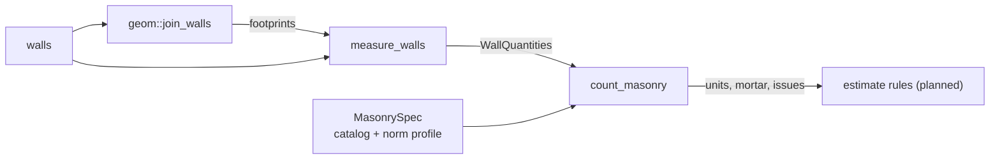

# engine/takeoff

Quantities from the joined plan: wall lengths, areas and volumes, then masonry units and mortar (расход кирпича и раствора). Pure functions; the same input gives the same output bits on every platform.



## Entry points

| API | Use |
|---|---|
| `measure_walls(walls, joins)` | Length, footprint area, face area and volume of each wall, sorted by id |
| `count_masonry(quantities, spec)` | Units and mortar per wall and in total, plus issues |
| `validate(spec)` | Checks unit and joint sizes typed by the user or read from content |

## Formulas

| Quantity | Formula |
|---|---|
| length, m | footprint area / thickness |
| face area, m² | length × height |
| volume, m³ | footprint area × height |
| wythes n | (thickness + head joint) / (unit width + head joint) |
| units | face area × n / ((unit length + head joint) × (unit height + bed joint)) |
| mortar, m³ | volume − units × unit volume |

A 380 mm wall of 1НФ brick with 12/10 mm joints (СП 70.13330.2012, 9.2.4) is three wythes:

```
 ┌─────────┐   ┌─────────┐   ┌─────────┐
 │   120   │10 │   120   │10 │   120   │   one course: 65 + 12 bed joint
 └─────────┘   └─────────┘   └─────────┘
 ◀──────────────── 380 ────────────────▶
```

Per m² of face that gives 149.9 units and 0.088 m³ mortar, matching the table in `docs/research`.

## Issues

| Case | Result |
|---|---|
| Thickness between whole wythes (300 mm of 120 mm brick) | Units pro rata, issue `kPartialWythe` |
| Wall thinner than one unit | No units, no mortar, issue `kThinnerThanUnit` |

## Invariants

- Joined outlines tile the plan, so lengths, volumes, units and mortar add up across walls with every corner counted once.
- Walls with a join overlap are measured as drawn; the overlap counts in both walls.
- Quantities are net. Waste allowances (запас), rounding to whole units or pallets and labour are estimate rules from `content/`.
- Openings are not subtracted yet; they arrive with the opening model.
- Coordinates and quantities use only `+ − × ÷`, so arm64 and x86-64 give the same bits.
