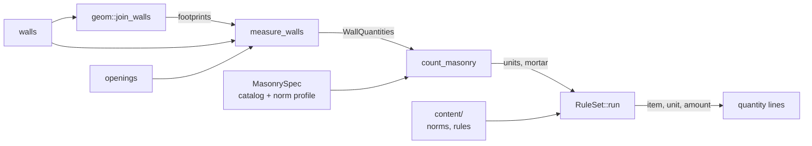

# engine/takeoff

Quantities from the joined plan: wall lengths, areas and volumes net of openings (проёмы), masonry units and mortar (расход кирпича и раствора), then material lines from the Luau rules in `content/`. The same input gives the same output bits on every platform.



## Entry points

| API | Use |
|---|---|
| `measure_walls(walls, openings, joins)` | Length, footprint area, face area, volume and openings area of each wall, sorted by id, plus opening issues |
| `count_masonry(quantities, spec)` | Units and mortar per wall and in total, plus issues |
| `validate(spec)` | Checks unit and joint sizes typed by the user or read from content |
| `RuleSet::compile({.norms, .rules})` | Compiles Luau scripts from `content/`; the caller passes their text |
| `RuleSet::run(walls, masonry, settings)` | Runs every rule in a fresh sandbox and returns validated lines |

## Formulas

| Quantity | Formula |
|---|---|
| length, m | footprint area / thickness |
| openings area, m² | union of the wall's openings on its face, clipped to the wall |
| face area, m² | length × height − openings area |
| volume, m³ | footprint area × height − openings area × thickness |
| wythes n | (thickness + head joint) / (unit width + head joint) |
| units | face area × n / ((unit length + head joint) × (unit height + bed joint)) |
| mortar, m³ | volume − units × unit volume |

A 380 mm wall of 1НФ brick with 12/10 mm joints (СП 70.13330.2012, 9.2.4) is three wythes:

```
 ┌─────────┐   ┌─────────┐   ┌─────────┐
 │   120   │10 │   120   │10 │   120   │   one course: 65 + 12 bed joint
 └─────────┘   └─────────┘   └─────────┘
 ◀──────────────── 380 ────────────────▶
```

Per m² of face that gives 149.9 units and 0.088 m³ mortar, matching the table in `docs/research`.

## Issues

| Case | Result |
|---|---|
| Opening past the wall's end or above its top | Only the part inside is cut, issue `kOutsideWall` |
| Two openings in one wall overlap | The shared part is cut once, issue `kOverlap` on both |
| Opening whose wall is missing (after a merge) | Ignored, issue `kNoWall` |
| Thickness between whole wythes (300 mm of 120 mm brick) | Units pro rata, issue `kPartialWythe` |
| Wall thinner than one unit | No units, no mortar, issue `kThinnerThanUnit` |

## Rules sandbox

[ADR 0005](../../docs/adr/0005-norm-rules-in-sandboxed-luau.md) records the decision; `content/README.md` has the contract for script authors.

| Guard | How |
|---|---|
| Same bits on every platform | Only `base`, `table`, `string` and exact `math`; compiled at level 0, so no builtin fast path reaches a removed function |
| No outside effects | No `os`, `debug`, `print`, `pcall`, `getfenv`; script text comes from the caller |
| No shared state | A fresh state per run, a fresh thread per script; norms, input, settings and globals are read-only |
| Bounded run | 1 000 000 steps per script call, 32 MiB per run; both end the run with `kRuleFailed` |
| Checked output | Lines must be `{ item, unit, amount }` with a known unit and a finite amount ≥ 0, else `kRuleOutput` |

## Invariants

- Joined outlines tile the plan, so lengths, volumes, units and mortar add up across walls with every corner counted once.
- Walls with a join overlap are measured as drawn; the overlap counts in both walls.
- `measure_walls` and `count_masonry` give net quantities. Waste (запас), rounding and cement come from the rules in `content/`.
- Openings are placed along the wall's location line, from its start and up from its base.
- Coordinates and quantities use only `+ − × ÷` and `√`, so arm64 and x86-64 give the same bits.
